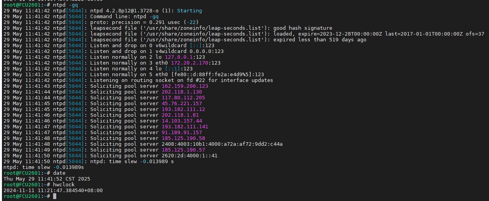

# Manual Time Synchronization (Forlinx Desktop 20.04)

Document classification: □ Top secret □ Secret □ Internal information ■ Open

## Copyright

The copyright of this manual belongs to Baoding Folinx Embedded Technology Co., Ltd. Without the written permission of our company, no organizations or individuals have the right to copy, distribute, or reproduce any part of this manual in any form, and violators will be held legally responsible.
Forlinx adheres to copyrights of all graphics and texts used in all publications in original or license-free forms.
The drivers and utilities used for the components are subject to the copyrights of the respective manufacturers. The license conditions of the respective manufacturer are to be adhered to. Related license expenses for the operating system and applications should be calculated/declared separately by the related party or its representatives.

## Overview
By default, the system enables automatic time synchronization. If you need more accurate time correction, or prefer not to use automatic time sync and want to set the time manually, follow the method in this document.

## Revision History
| **Date**    | **Manual Version**    | Revision History |
| --- | --- | --- |
| 29/05/2025 | V1.0    | Initial release    |

## 1. Introduction

If the deployment site has special requirements, for example in remote mountains or at sea, the device may not have continuous network access and can connect only briefly at certain times. To disable the automatic time sync service, which consumes system resources, and perform an immediate manual sync during those brief connections, use this method.

## 2. Modification Method
### 2.1 Disabling the Default Auto Time Sync Service
```plain
systemctl disable systemd-timesyncd.service
```

This service is the automatic time sync service enabled by default. Whenever the device can reach the internet, it periodically syncs the time, corrects the system time, and writes the system time to the RTC.

The command above removes the service's configuration symlink and disables the service from starting at boot.


### 2.2 Manual Time Sync
Run the following commands in order to install the time sync program:

```plain
apt-get update  # Update the local package list
apt-get install ntp
```

After installation, the ntp service also provides automatic time sync and starts on its own. To enable manual time sync, you must also disable the ntp service from starting at boot:

```plain
systemctl disable ntp
```

After disabling the service, reboot the device or stop the running service.

After that, whenever you need to sync the time, run the following command to perform a manual sync:

```plain
ntpd -gq
```

### 2.3 Saving the Time to RTC


After performing a manual sync with ntp, only the system time is corrected. Decide for yourself whether to save the time to the RTC chip.

If needed, you can set the system time manually:

```plain
date -s "2024-11-11 11:11:00" # The text inside the quotes is the time to set
```

Use the following command to save the system time to the RTC chip:

```plain
hwclock -wu
```

## 3. Common Issues
If special configuration or changes to the service process prevent the command for disabling startup from taking effect, use the command to mask the service:

```plain
systemctl mask systemd-timesyncd.service
```
