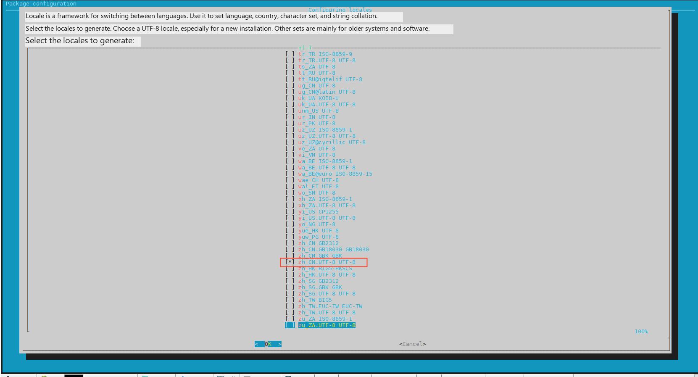

# Chinese Character Encoding in SSH Sessions (Forlinx Desktop 20.04)

Document classification: □ Top secret □ Secret □ Internal information ■ Open

## Copyright

The copyright of this manual belongs to Baoding Folinx Embedded Technology Co., Ltd. Without the written permission of our company, no organizations or individuals have the right to copy, distribute, or reproduce any part of this manual in any form, and violators will be held legally responsible.
Forlinx adheres to copyrights of all graphics and texts used in all publications in original or license-free forms.
The drivers and utilities used for the components are subject to the copyrights of the respective manufacturers. The license conditions of the respective manufacturer are to be adhered to. Related license expenses for the operating system and applications should be calculated/declared separately by the related party or its representatives.

## Revision History
| **Date**                | Manual Version | Revision History |
| --- | --- | --- |
| 22/09/2025     | V1.0                | Initial release                |

## Overview

This issue is caused by a mismatch between the system encoding and the terminal encoding. The encoding used by this system is not the commonly used Chinese encoding zh_CN.UTF-8, so it must be installed separately.

Use the following command to install it.

1. Update the software repository list

apt-get update

2. Install locales

apt-get install locales

3. Install Chinese encoding

dpkg-reconfigure locales

After installing locales, run this command, scroll to the bottom of the list, press Space to select zh_CN.UTF-8 UTF-8, and press Enter to start the automatic installation.

After installation, simply reboot and the encoding will be applied automatically. You can then use SSH to access the system remotely and view files with Chinese names normally.
