# Linux 4.19_User's Compilation Manual_V1.0

Document classification: □ Top secret □ Secret □ Internal information ■ Open

## Copyright

The copyright of this manual belongs to Baoding Folinx Embedded Technology Co., Ltd. Without the written permission of our company, no organizations or individuals have the right to copy, distribute, or reproduce any part of this manual in any form, and violators will be held legally responsible.

Forlinx adheres to copyrights of all graphics and texts used in all publications in original or license-free forms.

The drivers and utilities used for the components are subject to the copyrights of the respective manufacturers. The license conditions of the respective manufacturer are to be adhered to. Related license expenses for the operating system and applications should be calculated/declared separately by the related party or its representatives.

## 1. VMware Virtual Machine Software Installation
This chapter shows how to install VMware Workstation and configure a virtual machine, using version 17 Pro v17.0.0 as an example.

### 1.1 Downloading and Purchasing VMware Software
[Visit the VMware website](https://www.vmware.com/cn.html) to download Workstation Pro and get a product key. VMware is paid software; purchase a license, or use the trial version.

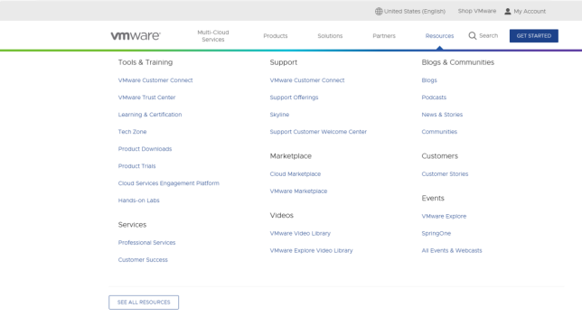

Once the download finishes, double-click the setup file to start the installation.

### 1.2 Installing VMware Software
Double-click the setup file to open the installation wizard, then click "Next".

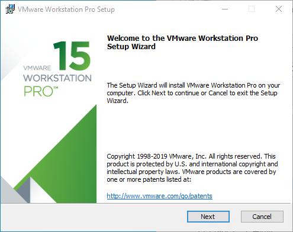

Select "I accept the terms in the License Agreement" and click "Next".

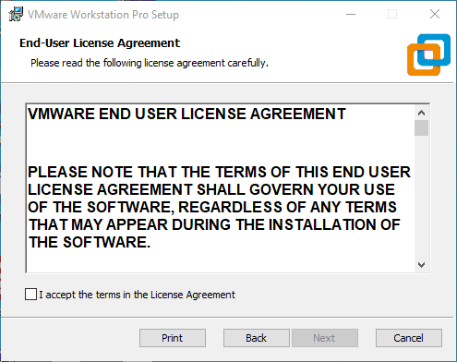

Change the install location to the partition where you install software, click "Next", then uncheck the boxes and click "Next"

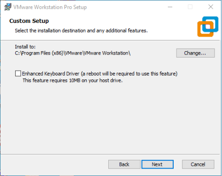

Check the shortcut options and click "Next".

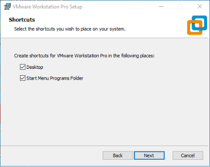

Click Install and wait for the installation to finish.

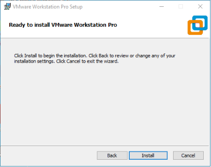

Click Finish to start the trial. For long-term use, purchase a license from the official site and enter the key.

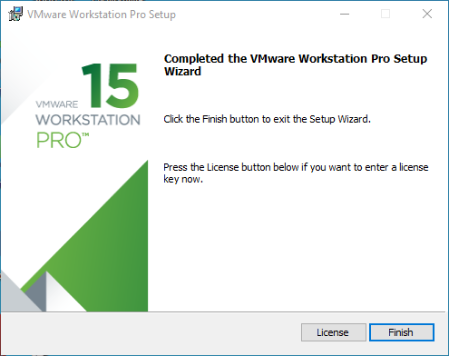

​     

## 2. Loading an Existing Ubuntu Development Environment
**Note:**

+ **Beginners should use the VM environment provided by Forlinx; the cross-compiler and Qt environment are already installed. After reading this chapter, you can jump straight to the build chapter;**
+ **The standard user for the development environment is forlinx (password: forlinx); the superuser is root (password: root);**
+ **Download site: Use the cloud-drive link provided by Forlinx (please ask your sales representative for the download link) to obtain the software and hardware documentation, source code, and development environment.**

There are two ways to use a VM environment in VMware: load an existing one or create a new one. This section covers loading an existing environment.

First, download the development environment from Forlinx; the package includes an MD5 checksum file. After downloading, verify the MD5 checksum of the archive (use an online MD5 tool or a local MD5 utility, whichever suits you) and compare it with the value in the checksum file. If they match, the download is intact; if not, the file may be corrupted, so download it again.


Select all the archives, right-click, and extract them to the current folder or a directory of your choice:


After extraction, you get the development environment OK3568-VM15.1.0-ubuntu18.04

**Note:**

+ **FCU2601 and 3568 use the same Ubuntu18.04 development environment;**
+ **The Vmware17.0.0 used in this demonstration is compatible with Vmware15.1.0 and does not affect later use.**

 The "3568.vmx" file in the "3568 Development Environment" folder is the one to open for the virtual machine.

Open the installed VMware Workstation.

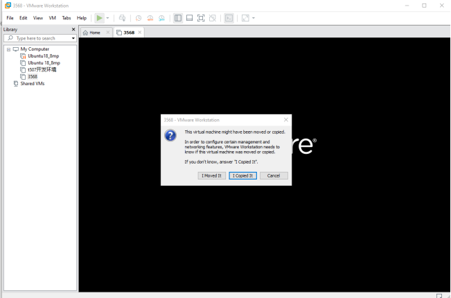

Select the directory containing the extracted 3568.vmx virtual machine file, then double-click the startup file


After loading, click Power On This Virtual Machine to boot into the system.

The development environment logs in automatically at boot as "forlinx" with password "forlinx".

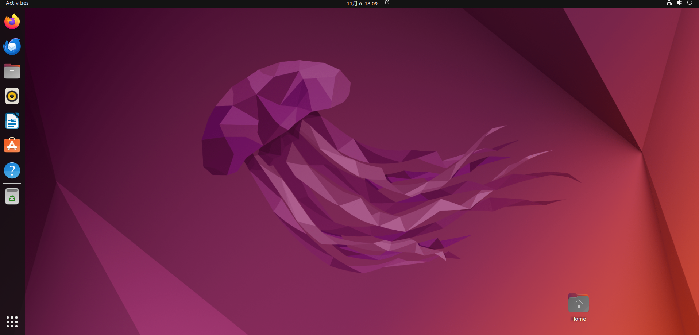

## 3. Setting Up a New Ubuntu Development Environment
**Note: Beginners should use the provided VM environment instead of building their own; skip this section if you do not need to set up an environment.**

**This chapter explains how to set up an Ubuntu system.**

### 3.1 Setting Up the Ubuntu System
The Ubuntu version used here is 18.04.3 LTS, and all descriptions and development in this manual were done on Ubuntu18.04.3 LTS. First, download the 64-bit Ubuntu18.04.3 LTS image from the Ubuntu website: [https://releases.ubuntu.com/bionic/](https://releases.ubuntu.com/bionic/)

#### 3.1.1 Creating an Ubuntu Virtual Machine
Step 1: Open VMware and click Create a New Virtual Machine. In the following screen, select "Custom (Advanced)" and click "Next":

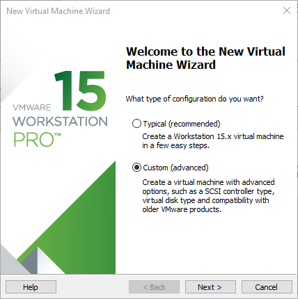

Step 2: Select the compatibility for your VMware version (check the version under Help -> About VMware Workstation), then click "Next":

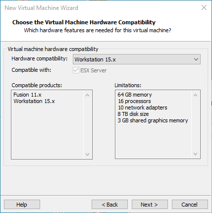

Select "Installer disc image file" and click "Next":

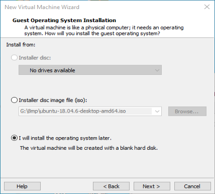

Enter your full name, username, and password, then click "Next":


Enter the virtual machine name and choose its location, then click "Next":


Set the number of processor cores, then click "Next":

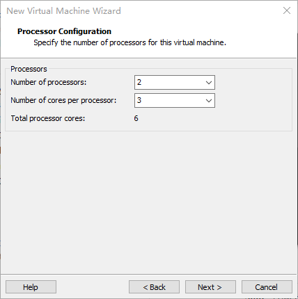

Allocate at least 8 GB of memory, then click "Next":

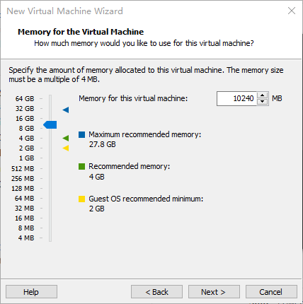

Set the network type to the default NAT mode, then click "Next". Keep the defaults for the remaining steps until you reach the disk capacity step.

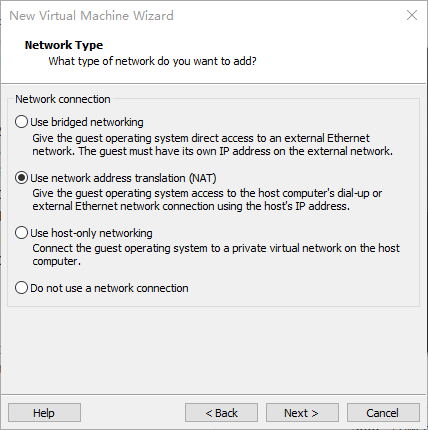

Use the recommended I/O controller type, then click "Next":

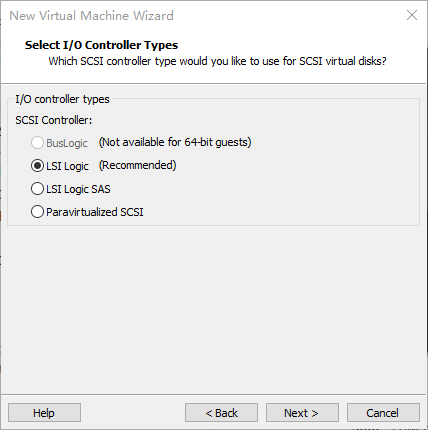

Use the recommended disk type, then click "Next":

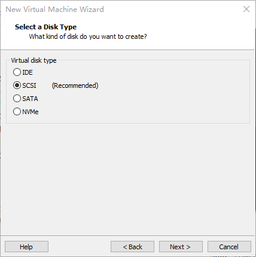

Keep the default option, Create a new virtual disk, then click "Next":

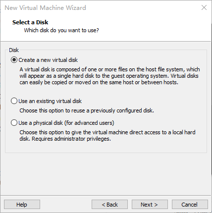

Set the disk size to 200 GB, split the virtual disk into multiple files, then click "Next":

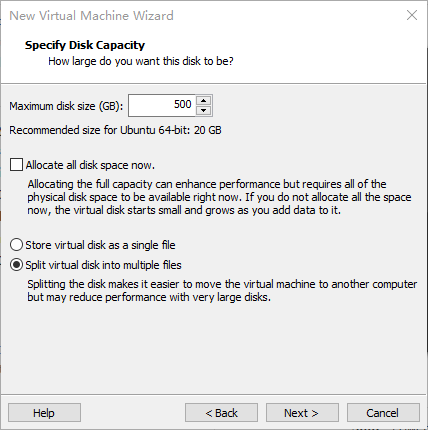

Keep the defaults and click "Next":


Click Finish:


The virtual machine is now created. Click Power On This Virtual Machine to start installing the image, and wait for it to finish. The Ubuntu installation is complete. The next section explains how to install Ubuntu in the virtual machine; the procedure is similar on a physical machine. This section covers installing Ubuntu in a virtual machine.

#### 3.1.2 System Installation
The previous section created a virtual machine but did not install an operating system, so it cannot boot yet. Next, install Ubuntu in this newly created virtual machine.

Step 1: First, get the 64-bit Ubuntu18.04 image from the Ubuntu website:

[http://sources.ubuntu.com/18.04/](http://releases.ubuntu.com/18.04/)

Right-click the created virtual machine and select Settings from the menu.


The "Virtual Machine Settings" dialog opens.

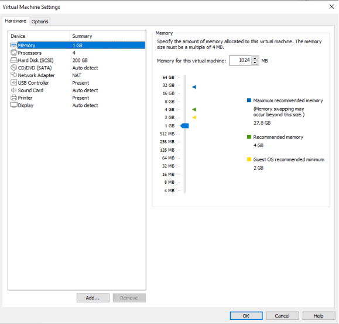

Click CD/DVD (SATA), select Use ISO image file, browse to the Ubuntu image downloaded earlier, then click OK.

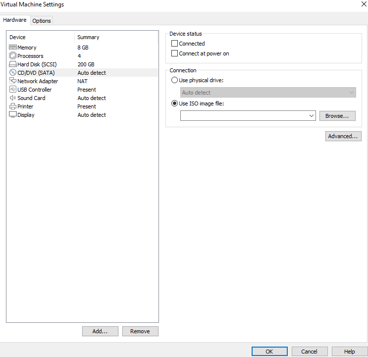

After setting the image, make sure the network is available, then power on the virtual machine to install the Ubuntu image.

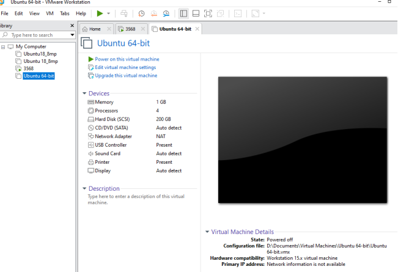

After the virtual machine starts, wait for the following installation screen:


Select a language from the list on the left, then click "Install Ubuntu" to open the language selection screen. Ubuntu defaults to English, but you can choose Chinese instead; the default language can also be changed later. After selecting, click continue.


Next, keep the default and click continue to proceed; the installation takes a while, then click "continue":


Keep the defaults, click Install Now, and in the dialog that appears, click continue:


Next, select the time zone: click the Shanghai time zone or type Shanghai (choose the time zone that applies to you), then click Continue.

Finally, set the username and password, choose automatic login or password login, then click continue to start the automatic installation.


If the network is poor, click Skip; it does not affect the installation.


Click Restart Now to reboot.


The system desktop after the reboot.


This completes the Ubuntu installation.

#### 3.1.3 Basic Ubuntu Configuration
After installing Ubuntu18.04, carry out a few configuration steps.

VMware Tools Installation:

Next, install VMware Tools. Without it, you cannot copy/paste or drag files between the Windows host and the virtual machine. First, click "Virtual Machine" on the VMware menu bar, then click "Install VMware Tools" in the drop-down list.


When done, switch to Ubuntu. A VMware Tools CD appears on the desktop; click to open it.


Inside, you will find an archive named VMwareTools-10.3.10-12406962.tar.gz (the name may vary with the VMware version). Copy it to the home directory (the home/<username> directory).


Press Ctrl+Alt+T to open a terminal and enter the command:

| forlinx@ubuntu:~$ sudo tar xvf VMwareTools-10.3.10-12406962.tar.gz |
| --- |


After extraction, a vmware-tools-distrib directory appears.


Back in the terminal, enter cd vmware-tools-distrib to move into that directory.

Then enter sudo ./vmware-install.pl, press Enter, and type your password to start the installation. Enter yes when prompted and press Enter to accept the defaults for everything else.


Once VMware Tools is installed, you can copy and paste files between Windows and Ubuntu.

Virtual Machine Full-Screen Display:

If the virtual machine does not display in full screen, click View, select Auto Resize, then click Fit Guest to enable full-screen display.


Most system settings are configured at the location shown. Most Ubuntu configuration needs can be handled here.


Virtual Machine Sleep Settings:

Also, the default sleep timeout is 5min. To disable sleep, set Power->Blank screen to Never.


### 3.1.4 Virtual Machine Network Settings
#### 3.1.4.1 NAT Connection Mode
By default, after the virtual machine is installed, its network connection mode is NAT as shown below, sharing one IP address with the host. You do not need to change it for tasks such as installing dependency packages or compiling code. In the virtual machine, when the VMware virtual network adapter is set to NAT mode, configure the Ubuntu network with a dynamic IP. In this mode, the virtual NAT device connects to the host network adapter to access the internet. This is the most common way for the virtual machine to access the external network.

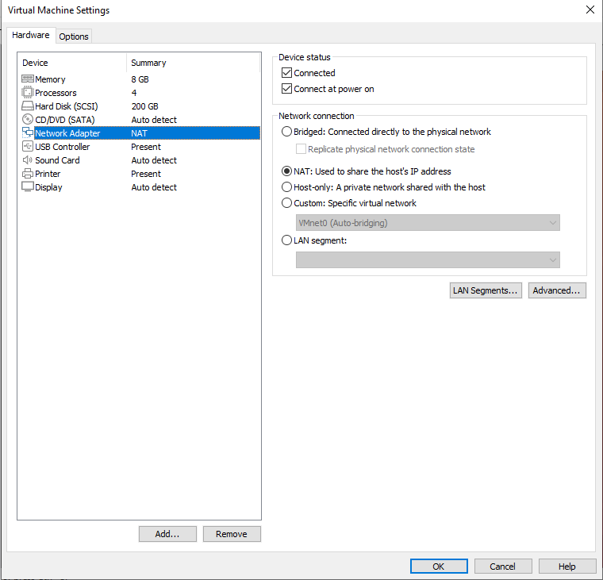

#### 3.1.4.2 Bridged Connection Mode
When the VMware virtual network adapter is in bridged mode, the host NIC and the virtual machine NIC communicate through a virtual bridge. Set the Ubuntu network IP in the same subnet as the host, and set the DNS to match the host NIC if internet access is needed. When using servers such as TFTP or SFTP, set the virtual machine's network connection mode to bridged.

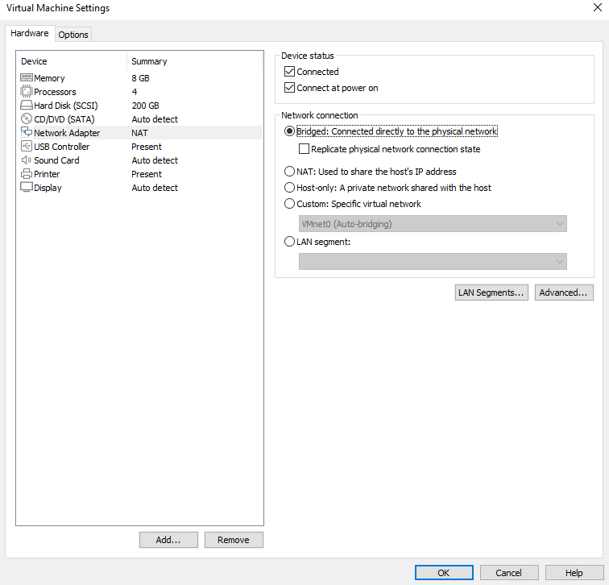

### 3.2 Install Libraries Required to Build the Linux System
**Note: If you use the development environment we provide, you can skip this section.**

Building the Linux system requires several tool packages. Before starting, make sure your computer or virtual machine has a working internet connection. If the network drops during installation, repeat the steps below.

Install the packages required to build Linux:forlinx@ubuntu:~$ sudo apt-get update

```bash
forlinx@ubuntu:~$ sudo apt-get update
forlinx@ubuntu:~$ sudo apt-get install openssh-server vim git fakeroot           //Installation of essential toolkits
forlinx@ubuntu:~$ sudo apt-get install repo git ssh make gcc libssl-dev liblz4-tool expect g++ patchelf chrpath gawk texinfo chrpath diffstat binfmt-support qemu-user-static live-build bison flex fakeroot cmake gcc-multilib g++-multilib unzip device-tree-compiler python-pip libncurses5-dev
forlinx@ubuntu:~$ sudo apt-get install -y expect time build-essential kmod python3.9
```

```bash
The network configuration tools and menuconfig also require the following libraries:
forlinx@ubuntu:~$ sudo apt-get update      // Update repository information\n
forlinx@ubuntu:~$ sudo apt-get install libncurses*             // Used to generate text-based user interfaces\n
forlinx@ubuntu:~$ sudo apt-get install net-tools               // Network configuration tools
```

### 3.3 Install the Cross-Compilation Toolchain
+ Materials/Linux/Cross-Compilation Toolchain/aarch64-buildroot-linux-gnu_sdk-buildroot.tar.gz

Copy the archive above to /home/forlinx/ in the development environment and extract it there:

```bash
forlinx@ubuntu:~$ tar -zvxf aarch64-buildroot-linux-gnu_sdk-buildroot.tar.gz      
```

Enter the aarch64-buildroot-linux-gnu_sdk-buildroot directory and run relocate-sdk.sh.

```bash
forlinx@ubuntu:~/aarch64-buildroot-linux-gnu_sdk-buildroot$ ./relocate-sdk.sh             
```

### 3.4 Qt Creator Installation
Copy qt-creator-opensource-linux-x86_64-4.1.0.run to any directory under the current user's home directory and run the command below.

+ Path: OK3588-C (Linux) User Materials\Linux\Source\qt-creator-opensource-linux-x86_64-4.7.0.run

forlinx@ubuntu:~/3588$ ./qt-creator-opensource-linux-x86_64-4.7.0.run                      


The graphical installation window then opens; follow the prompts to install:

	


For online installation, register a Qt account, or just log in if you already have one. The Qt password must contain uppercase letters, lowercase letters, and digits. After registering and logging in, click next.

For offline installation, click Skip.


Click "Next".


If needed, change the installation path; here we keep the default. Click ""Next"".


Select Full installation and click "Next".


Click install and wait for the installation to finish.


Once installation finishes, click finish. The Qt interface opens automatically. You can also launch Qt Creator from the command line in the background with the commands below; use your actual installation path:

forlinx@ubuntu:~$ cd /home/forlinx/qtcreator-4.7.0/bin

forlinx@ubuntu:~$ ./qtcreator &


The Qt Creator interface appears. Qt Creator is now installed.

## 4. Related Code Compilation

This chapter describes how to compile the board's source code, including the kernel source and applications.

**Note: The ubuntu system image does not grow automatically. Refer to the documentation to expand it.**

[http://bbs.witech.com.cn/article-605-1.html](http://bbs.witech.com.cn/article-605-1.html)

### 4.1 Preparations Before Compilation

#### 4.1.1 Environment Description

+ Development environment OS: Ubuntu18.04 64-bit
+ Cross-compilation toolchain: aarch64-linux-gnu
+ Board Bootloader version: u-boot-2017.09
+ Board kernel version: linux-4.19.206
+ Ported QT version on the board: qt5.14.2

#### 4.1.2 Copy the Source Code 
+ Program source code: User Materials\Linux\Source\OK3568-linux-source.tar.bz2

Create the working directory

```bash
forlinx@ubuntu:~$ mkdir -p /home/forlinx/work						// Create the working directories in order

Copy the source archive OK3588_Linux_fs.tar.bz2.0* from the user materials to the /home/forlinx/3588 directory in the virtual machine.

forlinx@ubuntu:~$ cd /home/forlinx/work									// Switch to the working directory

forlinx@ubuntu:~/work$ cat OK3568-linux-source.tar.bz2.0* > OK3568-linux-source.tar.bz2

forlinx@ubuntu:~/work$ tar -xvf OK3568-linux-source.tar.bz2			// Extract the archive in the current directory
```
Wait for the command to finish.

### 4.2 Source Code Compilation
**Note:**

+ **After extracting the kernel source for the first time, run a full build of the source first;**
+ **After the full build, build individual components separately if needed;**
+ **Compiling this source requires 16G or more of RAM in the development environment; do not modify the VM image configuration we provide.**

#### 4.2.1 Full Build Test

The source directory contains a build script, build.sh, that compiles the entire source tree. In a terminal, switch to the extracted source directory and locate build.sh.
```bash
forlinx@ubuntu:~$ cd /home/forlinx/work/OK3568-linux-source
```


Perform the following steps in the source directory for a full build:
```bash
forlinx@ubuntu: ~/work/OK3568-linux-source$ ./build.sh
```

The command prompts for a selection as shown below. Enter 1 and press Enter to continue.


**Note: If the prompt below does not appear, configuration is already complete and the build will finish normally. This step is optional.**

After compiling for a while, the screen below appears and requires a selection. From the information shown, choose 1800000 for VCCIO4 and VCCIO6 and 3300000 for the rest. Use the up/down arrow keys to select an option and press Enter to confirm.


After a successful build, the system image containing the buildroot-built file system is generated in the Image folder, as shown below:


**Note: update.img is the packaged image for full flashing via OTG or a TF card; the other files are for step-by-step flashing**

#### 4.2.2 Compiling the Kernel Independently
Work in the kernel source directory. After a successful build, the kernel in update.img is not updated. Flash the kernel/boot.img file separately.

```bash
forlinx@ubuntu: ~/work/OK3568-linux-source$ ./build.sh uboot // Compile U-Boot independently
// Generates uboot.img, with the output path at /OK3568-linux-source/u-boot/uboot.img

forlinx@ubuntu: ~/work/OK3568-linux-source$ ./build.sh kernel // Compile the kernel independently
// Generates boot.img, with the output path at /OK3568-linux-source/kernel/boot.img

forlinx@ubuntu: ~/work/OK3568-linux-source$ ./build.sh linuxfs // Compile the file system independently
// Generates rootfs.ext2, with the output path at /OK3568-linux-source/buildroot/output/OK3568/image/rootfs.ext2

forlinx@ubuntu: ~/work/OK3568-linux-source$ ./build.sh updateimg // Generate update.img independently
// Generates update.img using the uboot.img, boot.img and rootfs.ext2 from the paths specified above, and the resulting update.img is stored at rockdev/update.img
```
#### 4.2.3 Cleaning the Build Output
**Note: The clenall command deletes intermediate files in the uboot folder. Before using it, edit build.sh and comment out the uboot section. Our uboot is not open source; losing these intermediate files will prevent a full build.**

Work in the source directory. 
```bash
forlinx@ubuntu: ~/work/OK3568-linux-source$ ./build.sh cleanall
```

This clears all intermediate files but does not affect the source files, including ones you have already modified.

### 4.3 Image Files Usage
update.img is a complete package for full flashing over OTG or microSD card; the other files are for step-by-step flashing. Image files produced by a separate build are not updated in update.img, so flash them using single-step flashing (see the OTG Flashing section in the Software Manual).

### 4.4 Qt Creator Environment Configuration
Qt is a cross-platform graphics development library that supports many operating systems. Configure the Qt Creator build environment before compiling.

#### 4.4.1 Cross-Compiler Configuration
**Note: The cross-compiler path used by Qt Creator is generated only after a full source build. For convenience, we placed the host.tar archive in the /OK3568-C (Linux) User Materials/Tools directory. The absolute path created by our development environment is as follows: /home/forlinx/work/OK3568-linux-source/buildroot/output/OK3568. Extract host.tar to this path, then continue with this chapter. A full source build before this chapter is strongly recommended.**

- Click Qt Creator's Tools ->Options->Kits->Compilers, then click Add ->GCC->C;

- Set Name to GCC; /home/forlinx/work/OK3568-linux-source/buildroot/output/OK3568/host/bin/aarch64-linux-gcc

- For Compiler Path, click Browse and select the cross-compiler path: aarch64-linux-gcc and aarch64-linux-g++, as shown below:

- Path: OK3568-linux-source/buildroot/output/OK3568/host/bin

**Note: The buildroot output directory is generated only after a full source build.**


- Add the GCC compiler the same way: click "Add->GCC->C++" on the right, as shown below:


#### 4.4.2 Qt Versions Configuration
- Click Qt Creator's Tools ->Options->Qt Versions;

- Then click Add; in the dialog that opens, select OK3568-linux-source/buildroot/output/OK3568/host/bin/qmake;

- Click open to add it;


- You will return to the Qt Version configuration dialog, where you can change the Version name as needed;

- Then click Apply and OK.

#### 4.4.3 Kits Configuration
Kits is a build suite for building and selecting development and build environments, useful for projects with multiple QT libraries. Add the cross-compiler and QT Version added earlier to Kits to set up a build environment for the board.

- Click Qt Creator's Tools ->Options->Kits, then click Add; the configuration section appears;

- Change Name as needed;

- Set Compiler to GCC;

- Set Qt version to the name entered when you created the Qt version;

- Then click Apply and OK.


### 4.5 Compiling and Running Applications
#### 4.5.1 Compiling and Running a Command-Line Application
This section uses the watchdog test program; by default the source code is copied to /home/forlinx/3588.

Use the cd command to enter the test source directory:

```bash
forlinx@ubuntu:~$ cd /home/forlinx/work/OK3568-linux-source/app/forlinx/forlinx_cmd/fltest_watchdog
```
Add the cross-compiler path and cross-compile with make:

```bash
forlinx@ubuntu: ~/work/OK3568-linux-source/app/forlinx/forlinx_cmd/fltest_watchdog$ export PATH=/home/forlinx/3568/OK3568-linux-source/buildroot/output/OK3568/host/bin/:$PATH
# After configuring the cross-compiler path, you can directly execute `make` to trigger compilation via the Makefile

forlinx@ubuntu: ~/work/OK3568-linux-source/app/forlinx/forlinx_cmd/fltest_watchdog$ make
aarch64-linux-gcc watchdog.c -o fltest_watchdog  
Successfully generated fltest_watchdog!!!

# Alternatively, use the command below to directly call the cross-compiler for compilation
forlinx@ubuntu: ~/work/OK3568-linux-source/app/forlinx/forlinx_cmd/fltest_watchdog$ aarch64-linux-gcc watchdog.c -o fltest_watchdog
```


Use the file command to view information about the generated file:

```bash
forlinx@ubuntu:~/3588/OK3588_Linux_fs/app/forlinx/forlinx_cmd/fltest_watchdog$ 
file fltest_watchdog 
fltest_watchdog: ELF 64-bit LSB executable, ARM aarch64, version 1 (SYSV), dynamically linked, interpreter /lib/ld-linux-aarch64.so.1, for GNU/Linux 3.7.0, not stripped
```

The result shows that the build produces a 64-bit ARM file.

Copy the compiled fltest_watchdog to the board using a USB drive, ftp, or similar, for example into /forlinx. The example below uses a microSD card: copy it to the board and run the test.

```bash
root@FCU2601:/# cp /run/media/sda1/fltest_watchdog /home/forlinx/
root@FCU2601:/# cd /home/forlinx/
root@FCU2601:/home/forlinx# ./fltest_watchdog
Watchdog Ticking Away!
```

See the "Watchdog Test" section of the User Manual for the test procedure.

#### 4.5.2 Compile and Run a QT Application
Open Qt Creator in the development environment (open it from your own path), then click Qt Creator's File->Open File or Project. In the window that opens, select /work/OK3568-linux-source/app/forlinx/forlinx_qt/watchdog/watchdog.pro


After opening the project, the interface appears as shown below (if the page does not switch automatically, select it as shown in the screenshot).


Click Configure Project to use the build environment set up in the "Qt Creator Environment Configuration" section of this manual.

After selection, the interface appears as shown below:


Click Build->Clean All to clean up. (If intermediate files remain, delete them manually.)

Click Projects and uncheck Shadow build.


Then click Build->Build All to compile.


When the Build progress bar in the lower-right corner finishes, the build is complete. The newly generated binary fltest_qt_watchdog then appears in /app/forlinx/forlinx_qt/watchdog, as shown below:


Copy the compiled executable to the development board via USB drive, ftp, or similar, then run the test.
