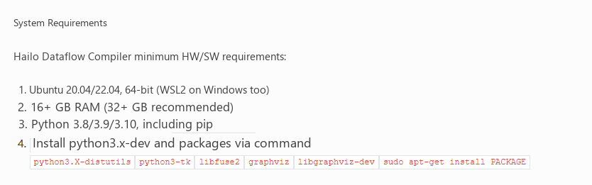
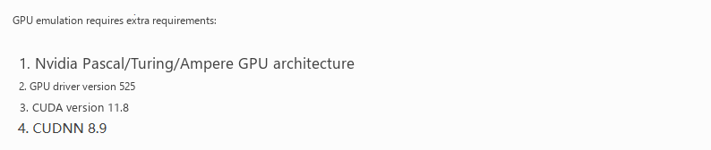
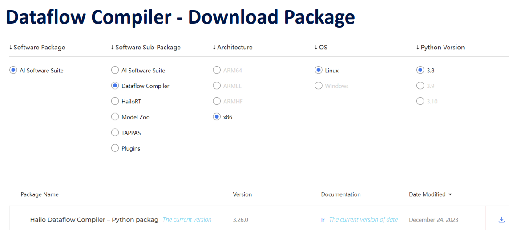
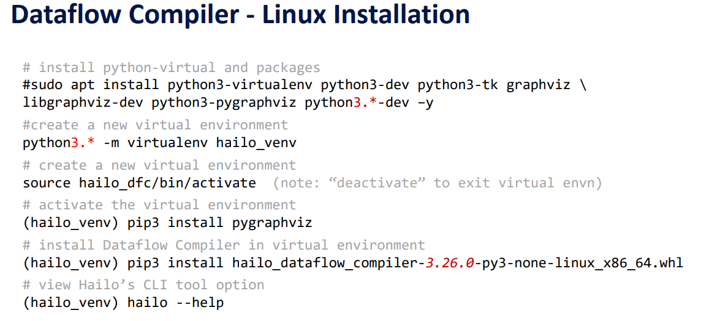
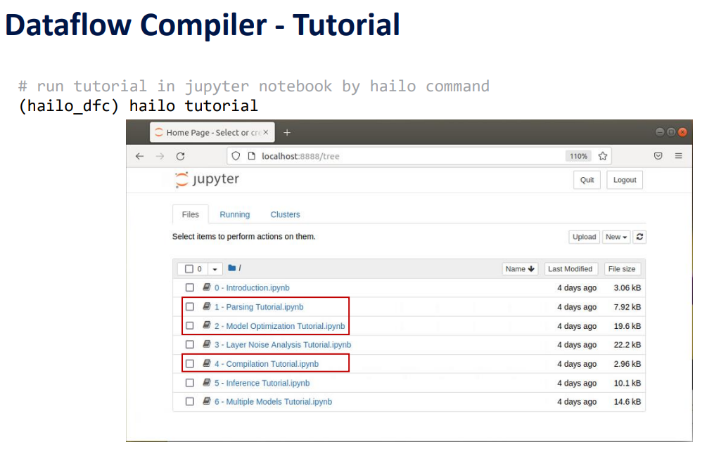
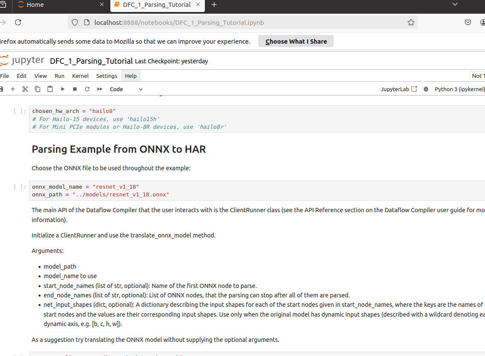
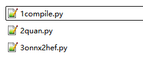

# Hailo AI Accelerator Build Guide_V1.0

Document classification: □ Top secret □ Secret □ Internal information ■ Open

## Copyright

The copyright of this manual belongs to Baoding Folinx Embedded Technology Co., Ltd. Without the written permission of our company, no organizations or individuals have the right to copy, distribute, or reproduce any part of this manual in any form, and violators will be held legally responsible.

Forlinx adheres to copyrights of all graphics and texts used in all publications in original or license-free forms.

The drivers and utilities used for the components are subject to the copyrights of the respective manufacturers. The license conditions of the respective manufacturer are to be adhered to. Related license expenses for the operating system and applications should be calculated/declared separately by the related party or its representatives.

## Build Guide

### 1.1 Model Conversion Steps
Converting to a HEF file takes about three steps:  
1. Write a deep learning model in ONNX and convert it to a HAR file  
2. Quantize the model by adding a representative dataset and convert it to a quantized HAR file  
3. Compile it into a HEF file

### 1.2 System Requirements for Model Conversion
Environment dependencies required by Dataflow Compiler v3.28.0 (hailo.ai) v3.28





### 1.3 Required Libraries and Packages for the Dataflow Compiler Model Converter
Dataflow Compiler installs and runs Tensorflow. However, when Tensorflow is installed from PyPi and runs on a CPU, AVX instruction support is also required. Therefore, use a CPU that supports AVX instructions and meets the requirements below. Alternatively, build Tensorflow from source without AVX.



sudo apt install python3-virtualenv  python3-tk   graphviz libgraphviz-dev python3-pygraphviz

### 1.4 Python Venv Environment Setup


This environment is set up on a pc running ubuntu20 or Ubuntu22.

### 1.5 Detailed Steps for Using the Dataflow Compiler




The program uses from hailo_sdk_client import ClientRunner.

Use clientRunner to convert onnx to har. The main API for interacting with the Dataflow Compiler is the ClientRunner class (for more information, see the "API Reference" section in the Dataflow Compiler User Guide).

Initialize ClientRunner and call the translate_onx_model method.

Arguments:

*Model path

*Name of the model to use

*start_node_names (list of str, optional): names of the first ONNX nodes to parse.

*end_node_names (list of str, optional): list of ONNX nodes where parsing can stop after all nodes are parsed.

*net_input_shapes (dict, optional): a dictionary that describes the input shape of each start node given in start_node_names, where the keys are the start node names and the values are their corresponding input shapes. Use it only when the original model has dynamic input shapes (described with wildcards representing each dynamic axis, for example [b, c, h, w]).

Try translating the ONNX model first without passing any optional arguments.

Hailo Archive:

Hailo Archive is a tar.gz archive that captures the "state" of the model: the files and attributes used at a given stage from parsing to compilation. Use the save_har method to save the runner state at any stage, and use load_har to load a saved state into an uninitialized runner.

The initial HAR file includes:

An HN file, which is a JSON-like representation of the graph structure deployed to Hailo hardware.

An NPZ file, which contains the model weights.

```plain
# General imports used throughout the tutorial
import tensorflow as tf
from IPython.display import SVG

# import the ClientRunner class from the hailo_sdk_client package
from hailo_sdk_client import ClientRunner

chosen_hw_arch = "hailo8"
# For Hailo-15 devices, use 'hailo15h'
# For Mini PCIe modules or Hailo-8R devices, use 'hailo8r'

onnx_model_name = "resnet_v1_18"
onnx_path = "../models/resnet_v1_18.onnx"

runner = ClientRunner(hw_arch=chosen_hw_arch)
hn, npz = runner.translate_onnx_model(
    onnx_path,
    onnx_model_name,
    start_node_names=["input.1"],
    end_node_names=["191"],
    net_input_shapes={"input.1": [1, 3, 224, 224]},
)
hailo_model_har_name = f"{onnx_model_name}_hailo_model.har"
runner.save_har(hailo_model_har_name)


# HAR file
runner = ClientRunner(har=hailo_model_har_name )
# By default it uses the hw_arch that is saved on the HAR. It is not recommended to change the hw_arch after Optimization.

hef = runner.compile()

file_name = f"{model_name}.hef"
with open(file_name, "wb") as f:
f.write(hef)

har_path = f"{model_name}_compiled_model.har"
runner.save_har(har_path)
!hailo profiler {har_path}
```

During quantization,

```plain
alls_lines = [
    # Add normalization layer with mean [0.0, 0.0, 0.0] and std [255.0, 255.0, 255.0])
    'normalization1 = normalization([0.0, 0.0, 0.0],[255.0, 255.0, 255.0])\n',
    # calibration dataset
    f'model_optimization_config(calibration,  calibset_size={len(calib_dataset)}, batch_size=2)\n',  # Batch size is 8 by default

    # set enabled to let Haiol8 do sigmoid on outputs
    # if commented out the output sigmoid, must give bActivateSigmoid 'false' when initial network
    #     static Yolov5NmsDecoder<uint8_t> Yolov5Decoder(false);
    #'change_output_activation(sigmoid)\n', #by lide test  
    
    # 1. will take longer to compile the network at final step of 3-Compilation.ipynb
    #    (about 1 hour in intel i7 platform)
    # 2. If comiliation timeout in 3-Compilation.ipynb, back to here disable this command and retrun quantization and compilation
    #'performance_param(compiler_optimization_level=max)\n', 
    
]
```

The blue sections in the program can be enabled or disabled. When disabled, the output stays largely consistent with the original onnx; when enabled, quantization takes longer and introduces some validation loss.

### 1.6 Source Code for the Conversion Steps
In the hailo_DFC folder, the three steps of compilation, quantization, and conversion are provided. Run them in numerical order.



The code takes the yolov5s.onnx to hef conversion as an example and produces yolov5s.hef as output.
