# Hailo Deployment and Applications

Document classification: □ Top secret □ Secret □ Internal information ■ Open

## Copyright

The copyright of this manual belongs to Baoding Folinx Embedded Technology Co., Ltd. Without the written permission of our company, no organizations or individuals have the right to copy, distribute, or reproduce any part of this manual in any form, and violators will be held legally responsible.
Forlinx adheres to copyrights of all graphics and texts used in all publications in original or license-free forms.
The drivers and utilities used for the components are subject to the copyrights of the respective manufacturers. The license conditions of the respective manufacturer are to be adhered to. Related license expenses for the operating system and applications should be calculated/declared separately by the related party or its representatives.

## Hailo Introduction
Inference based on the compute power of the Hailo8 module.

Environment: Ubuntu22  rk3588

Python: 3.10

HailoRT runtime library: 3.18.0

Inference model: yolov8s_pose_mz.hef

This corresponds to the pyhaiort content.

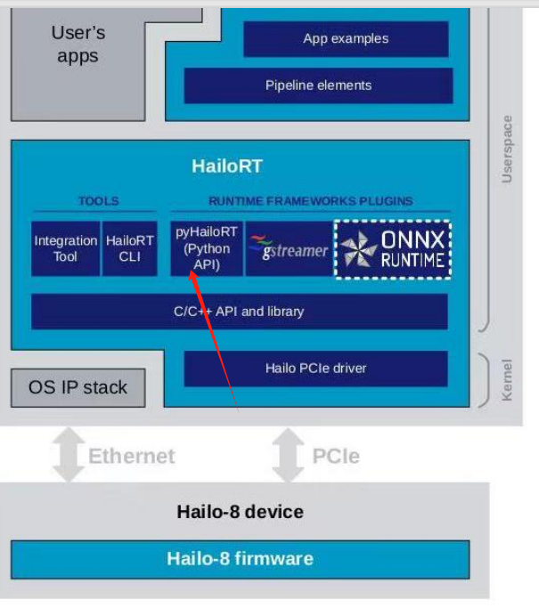

The main APIs used are as follows:

```plain
// Function interface for getting the device information list
devices = Device.scan()
// Get the model's
    hef = HEF(args.hef)
num_of_classes =1

// Get the model's supported input layers
inputs = hef.get_input_vstream_infos()
// Get the model's supported outputs
outputs = hef.get_output_vstream_infos()
// Use the specified device information as the inference target
    with VDevice(device_ids=devices) as target:
        configure_params = ConfigureParams.create_from_hef(hef, interface=HailoStreamInterface.PCIe)
        network_group = target.configure(hef, configure_params)[0]
        network_group_params = network_group.create_params()
# Print the corresponding model parameters
        [log.info('Input  layer: {} {}'.format(layer_info.name, layer_info.shape)) for layer_info in inputs]
        [log.info('Output layer: {} {}'.format(layer_info.name, layer_info.shape)) for layer_info in outputs]

        height, width, _ = hef.get_input_vstream_infos()[0].shape
        // Get model information and network group
        kwargs['img_dims'] = (height,width)

        input_vstream_info = hef.get_input_vstream_infos()[0]

        input_vstreams_params = InputVStreamParams.make_from_network_group(network_group, quantized=False, format_type=FormatType.FLOAT32)
        output_vstreams_params = OutputVStreamParams.make_from_network_group(network_group, quantized=False, format_type=FormatType.FLOAT32)
// Bind the current parameters as the inference model
with InferVStreams(network_group, input_vstreams_params, output_vstreams_params) as infer_pipeline:
// Inference
raw_detections = infer_pipeline.infer(input_data)
```

Overall Inference Steps

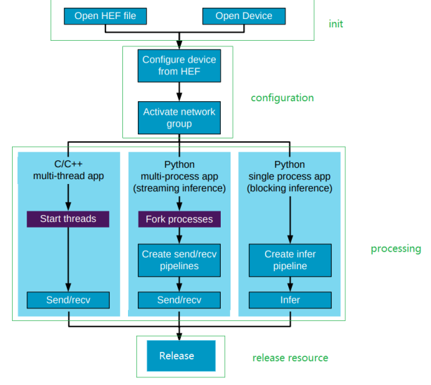

Inference stages

• Initiation • Import the model and initialize the Hailo device

• Configuration • Configure the model group and its corresponding input/output streams, and activate the network model

• Process /Inference • Perform inference using virtual streams

• Release • Release resources

## Yolov8 Object Detection
Open the folder User Materials->hailodemo ->python ->object_detection .

Transfer yolov8m.hef and inference.py to the 3501 board, then run the command:

python  inference.py  -n  yolov8.hef    -i  zidan.jpg

The output is as follows:

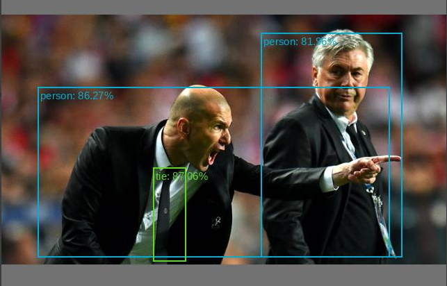

## Yolov8 Real-Time Camera Detection
Open the folder User Materials->hailodemo ->python ->object_detection .

Transfer yolov8m.hef and object_detection_camera.py to the 3501 board, then run the command:

python  object_detection_camera.py  -n  yolov8.hef


## Image Semantic Segmentation - fc8-restnet Road
Open the folder User Materials->hailodemo ->python ->semantic_segmentation .

Check whether the folder contains the content in the red box:

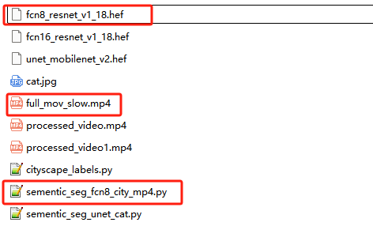

Transfer that content to the 3501 board.

Grant execute permissions to all executable files.

python/semantic_segmentation$ sudo   chmod   +x   *

Then run the command:

python3 sementic_seg_fcn8_city_mp4.py fcn8_resnet_v1_18.hef  -i  full_mov_slow.mp4

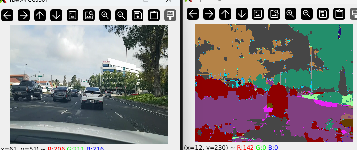

- **Image Semantic Segmentation - unet Cat Segmentation**

Open the folder User Materials->hailodemo ->python ->semantic_segmentation .

Command to segment the cat using UNet:

python3 sementic_seg_unet_cat.py -hef  unet_mobilenet_v2.hef

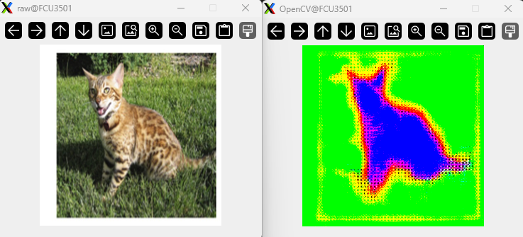

**Instance Segmentation with yolov5seg and yolov8seg**

Open the folder User Materials->hailodemo ->python ->instance_segmentation.

The folder contains the following:

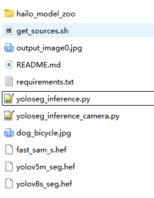

If the folder does not contain yolov5m_seg.hef and yolov8s_seg.hef, you can run ./get_sources.sh to download the resources mentioned in the file, deploy them to the 3501 board, and perform image recognition. Use yolov5 to segment the image.

Run the command:

python3 yoloseg_inference.py  yolov5m_seg.hef    dog_bicycle.jpg  v5  --output_dir  .

The parameters above specify the yolov5m_seg.hef model and the input image dog_bicycle.jpg.

The architecture is v5, and the output path is the current directory ".".

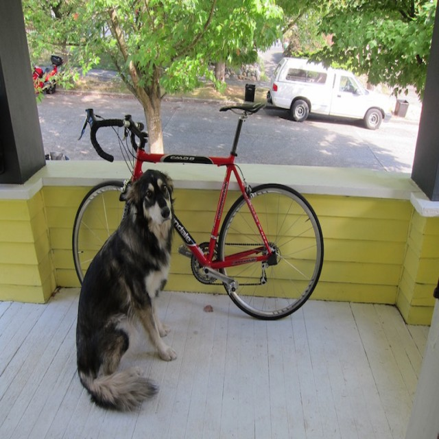

Original Image

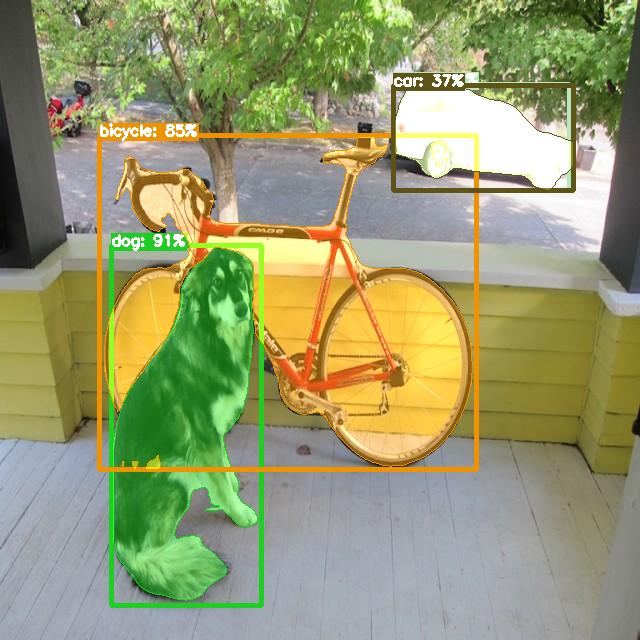

yolov5 Segmentation Output

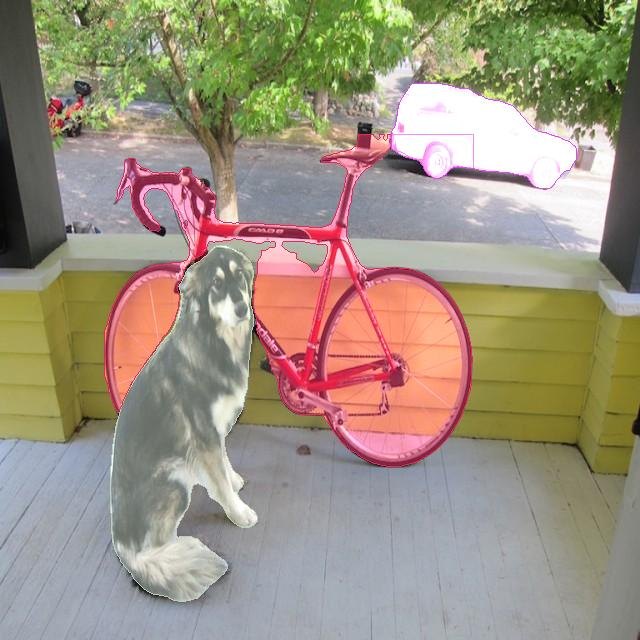

yolov8s seg Output

**Semantic Segmentation Using a USB Camera**

Open the folder User Materials->hailodemo ->python ->instance_segmentation.

Command: python3  yoloseg_inference_camera.py

The USB camera is     cap = cv2.VideoCapture('/dev/video1')

The default model is yolov8s. 

The real-time recognition image is as follows:

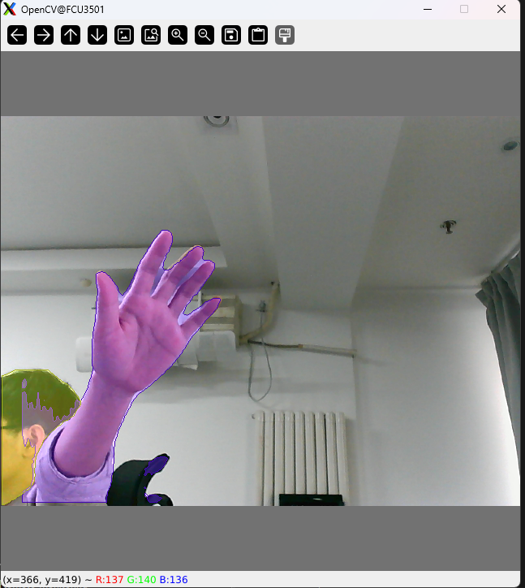

**FastSam Segment Anything**

Open the folder User Materials->hailodemo ->python ->instance_segmentation.

Command:

python3  yoloseg_inference_camera.py  --hef  fast_sam_s.hef  --arch fast

The parameters above specify the fast_sam_s.hef model and the fast architecture.

The USB camera is     cap = cv2.VideoCapture('/dev/video1')

The real-time recognition image is as follows:

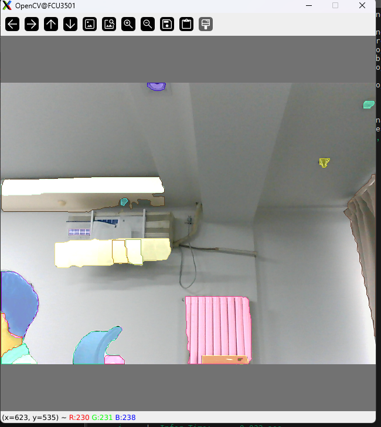

**Pose Estimation**

Open the folder User Materials->hailodemo ->python ->pose_estimation.

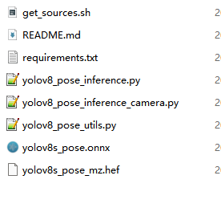

Use the hailortcli tool to test the yolov8s_pose_mz.hef model:

```plain
forlinx@ok3588:~/app/python/pose_estimation$ 
hailortcli  run  yolov8s_pose_mz.hef

Running streaming inference (yolov8s_pose_mz.hef):
  Transform data: true
    Type:      auto
    Quantized: true
Network yolov8s_pose/yolov8s_pose: 100% | 989 | FPS: 197.50 | ETA: 00:00:00
> Inference result:
 Network group: yolov8s_pose
    Frames count: 989
    FPS: 197.50
    Send Rate: 1941.55 Mbit/s
    Recv Rate: 2349.20 Mbit/s

forlinx@ok3588:~/app/python/pose_estimation$
```

First confirm that the camera is installed correctly; by default, cam1 is used (.dev/video55). Read a frame through the opencv interface cap.read(), pass it to the device for inference, and then retrieve the result.

```plain
def Camera_isOpened():
    global  cap
        # Start capturing the camera video stream
    cap = cv2.VideoCapture('/dev/video55')
try:
    Camera_isOpened()
except:
    print('Unable to detect camera! \n')
# ---------------- Start of the example --------------------- #


        while True:
            with InferVStreams(network_group, input_vstreams_params, output_vstreams_params) as infer_pipeline:
                if cap.isOpened():
                    # Continuously capture the video stream
                    ret, orgFrame = cap.read()
                    #print(orgFrame.shape)
                    cnt += 1
                    img = Image.fromarray(orgFrame)#
                    processed_image = preproc(img, height=height, width=width)
                    # Convert the image to 1x640x640            
                    input_data = {input_vstream_info.name: np.expand_dims(processed_image, axis=0).astype(np.float32)}
```

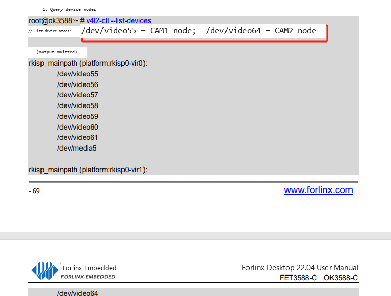

If using a USB camera, confirm the device number.

Run the program python3  yolov8_pose_inference_camera.py  yolov8s_pose_mz.hef

The following parameter specifies using yolov8s_pose_mz.hef as the pose detection model.

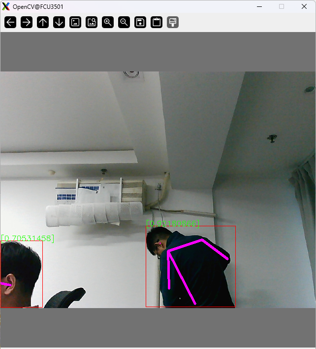

Inference speed for a single frame, single thread, and single batch is 30 ms. In a continuous 1-hour test, no frames were dropped and there was no lag.

**Depth Estimation fastdepth**

Open the folder User Data->hailodemo ->python ->depth_estimation.

This example provides the inference source code, the hef model file, and test images.

Command:

python3   mono_inference_fastdepth.py   fast_depth.hef    -i  IMG_0186.jpg

The image is:

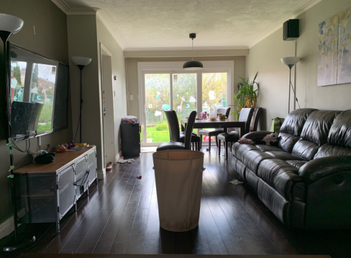

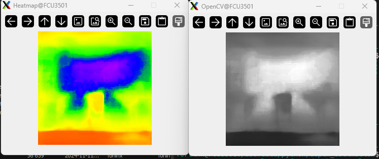
