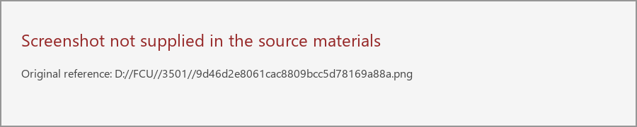

# Samba Network Share Configuration

Document classification: □ Top secret □ Secret □ Internal information ■ Open

## Copyright

The copyright of this manual belongs to Baoding Folinx Embedded Technology Co., Ltd. Without the written permission of our company, no organizations or individuals have the right to copy, distribute, or reproduce any part of this manual in any form, and violators will be held legally responsible.
Forlinx adheres to copyrights of all graphics and texts used in all publications in original or license-free forms.
The drivers and utilities used for the components are subject to the copyrights of the respective manufacturers. The license conditions of the respective manufacturer are to be adhered to. Related license expenses for the operating system and applications should be calculated/declared separately by the related party or its representatives.

# **Overview**
This document explains how to configure a **Samba (SMB/CIFS) network shared folder** on the **FCU3501 (aarch64, Ubuntu 22.04)** so that Windows / Linux / macOS / industrial HMI and other devices on the LAN can directly read from and write to a storage area on the device.

Typical use cases:

+ **On-site data collection**: Data captured/recorded by the device (logs, video clips, AI snapshot images) goes directly into the shared directory. Engineers can open and retrieve it from their own PCs without using SSH + scp every time.
+ **File updates without flashing**: To update algorithm models, configuration files, or scripts, just drag the files into the shared drive, eliminating USB drives and serial transfers.
+ **Debugging and forensics**: Drop dmesg output, core dumps, and log bundles from a crash/failure scene into the shared directory for collaborative analysis by multiple people.

This document presents a **fully open anonymous read/write** solution (any device on the LAN can read and write without a username or password), and Chapter 6 provides two more secure variants: **username/password authentication** and **anonymous read-only + authenticated write**.

> **Key Note:** The FCU3501 factory system**includes only the **`samba-libs`** library files, not the Samba server**. You must install it yourself with `apt install samba`, which requires the device to have internet access.
>

# **Revision History**
| **Date** | **Manual Version** | **Changes** |
| --- | --- | --- |
| 2026.8.18 | V1.0 | Initial release: Samba anonymous read/write share deployment + client access + verification + security hardening variants (based on testing on FCU3501) |


# Deployment Environment and Prerequisites
| Check Item | Measured Value |
| --- | --- |
| Device | FCU3501 (Forlinx complete unit) |
| CPU Architecture | aarch64 (arm64) |
| Operating System | Ubuntu 22.04.4 LTS (jammy) |
| Kernel | 5.10.209 |
| Device IP | 172.20.2.184 (eth0, static) |
| Login Account | forlinx / forlinx (in the sudo group) |
| Shared Directory | `/userdata/share` |
| Shared Space | 97 G partition, 84 G available |
| Samba Version | 4.15.13 (Ubuntu 22.04 repository version) |
| Client | Windows 11 (10.0.26200) |


Verification commands:

```bash
uname -a                    # Confirm it is indeed FCU3501 / aarch64
cat /etc/os-release         # Ubuntu 22.04
ip -4 addr show eth0        # Confirm the wired Ethernet port IP
df -h                       # Confirm /userdata partition space
ping -c 2 archive.ubuntu.com  # Confirm internet access (for package installation)
```

> **⚠**** Check the partition first!** The FCU3501 root partition `/` is only **14 G and 78% full (3 G remaining)**, while `/userdata` is a separate **97 G large partition**.  
**The shared directory must be placed under **`/userdata`**.** If you take the easy route and put it in `/home` or `/opt` (both on the root partition), a colleague copying a few videos into it can fill up the root partition. At best, services malfunction; at worst, the system fails to boot. This is one of the common triggers of "crash-type" issues.
>

# 1. Installing the Samba Server
The FCU3501 ships with only `samba-libs`; you need to install the server:

```bash
sudo apt-get update
sudo apt-get install -y samba samba-common-bin smbclient
```

Descriptions:

+ `samba`: Core server (provides the `smbd` file service and `nmbd` NetBIOS name service)
+ `samba-common-bin`: Configuration validation tools such as `testparm`
+ `smbclient`: Command-line client, **used for local self-testing on the device after installation**; strongly recommended

Installation automatically creates the `sambashare` group and registers `smbd` and `nmbd` to start at boot. These two lines in the installation log are **normal and can be ignored**:

```plain
Samba is not being run as an AD Domain Controller: Masking samba-ad-dc.service
/usr/bin/deb-systemd-helper: error: systemctl preset failed on samba-ad-dc.service
```

This is because this setup is a standalone file server (ROLE_STANDALONE), not a domain controller, so the AD domain controller service is deliberately masked.

Verify the installation:

```bash
which smbd nmbd smbpasswd testparm
smbd --version              # Version 4.15.13-Ubuntu
```

# 2. Creating the Shared Directory
```bash
sudo mkdir -p /userdata/share
sudo chown -R forlinx:forlinx /userdata/share
sudo chmod -R 0777 /userdata/share
```

+ **Set the owner to **`forlinx`**: This matches the `force user = forlinx` setting in the configuration below, ensuring that files written over the network are also owned by forlinx locally. After SSH login you can read and write them directly, avoiding permission conflicts where "the network can modify them but the local system cannot."
+ **Permissions 0777**: Required for the open anonymous solution. If you use the authentication solution in Chapter 6, you can tighten this to 0775 or 0770.

# 3. Writing the Samba Configuration
## 3.1 Backing Up the Original Configuration
```bash
sudo cp /etc/samba/smb.conf /etc/samba/smb.conf.orig
```

> It is recommended to add a check to avoid overwriting the backup on repeated runs:  
`[ -f /etc/samba/smb.conf.orig ] || sudo cp /etc/samba/smb.conf /etc/samba/smb.conf.orig`
>

## 3.2 Writing the Configuration
```bash
sudo tee /etc/samba/smb.conf > /dev/null <<'EOF'
#======================= Global Settings =======================
[global]
   workgroup = WORKGROUP
   server string = FCU3501 Shared Storage
   netbios name = FCU3501
   security = user
   map to guest = Bad User
   guest account = nobody

   # Allow SMB1/NTLM negotiation for older/lightweight clients (some industrial HMIs, legacy Android devices)
   server min protocol = NT1
   ntlm auth = yes

   log file = /var/log/samba/log.%m
   max log size = 500
   logging = file
   panic action = /usr/share/samba/panic-action %d

   # Listen only on the wired port and loopback to avoid exposure to Docker bridges
   interfaces = lo eth0
   bind interfaces only = yes

   # Disable printer-related features to reduce unnecessary services
   load printers = no
   printing = bsd
   printcap name = /dev/null
   disable spoolss = yes

#======================= Share Definitions =====================
[share]
   comment = FCU3501 Public Share (anonymous read/write)
   path = /userdata/share
   browseable = yes
   read only = no
   writable = yes
   guest ok = yes
   guest only = yes
   force user = forlinx
   force group = forlinx
   create mask = 0666
   directory mask = 0777
   veto files = /.DS_Store/._*/Thumbs.db/
   delete veto files = yes
EOF
```

## 3.3 Key Configuration Options Explained
Field FAEs should focus on this section so they know which line to change when requirements change.

**Required combination for anonymous write access** (all are mandatory; this is the most common source of misconfiguration):

| Option | Effect |
| --- | --- |
| `security = user` | Standard user-level security mode; a prerequisite for the `map to guest` setting below to take effect |
| `map to guest = Bad User` | **Core**: When a client submits a username that does not exist on the system, automatically downgrade to guest instead of rejecting it. If set to `Never` (the default), all anonymous access is rejected |
| `guest account = nobody` | The system account that guest sessions map to |
| `guest ok = yes` | Allows guest access to this share |
| `guest only = yes` | Forces all access to this share through guest; the client will not prompt for a password |


**Permission-related**:

| Option | Effect |
| --- | --- |
| `force user = forlinx`   `force group = forlinx` | **Strongly recommended to keep**. All network write operations are written to disk as forlinx, so files are owned by forlinx rather than nobody. Benefit: you can work with these files directly after SSH login. Drawback: you cannot tell who wrote them (the anonymous solution cannot distinguish users anyway) |
| `create mask = 0666` | Permissions for newly created files, ensuring anyone can read and write them later |
| `directory mask = 0777` | Permissions for newly created directories, ensuring they can be entered and written to |


**Security boundary**:

| Option | Effect |
| --- | --- |
| `interfaces = lo eth0`   `bind interfaces only = yes` | **Must be set**. FCU3501 runs Docker, with multiple bridges such as `docker0` and `br-*` (172.17/172.18/172.19/172.21 subnets). Without restricting interfaces, Samba exposes a share on all these networks, and programs inside containers can access it, enlarging the attack surface |


**Compatibility**:

| Option | Effect |
| --- | --- |
| `server min protocol = NT1`   `ntlm auth = yes` | Compatible with clients that only speak SMB1/NTLMv1, such as some older industrial HMIs, legacy Android devices, and old printers. **If all on-site clients are Win10/11 or newer, change to **`server min protocol = SMB2`** to improve security** (SMB1 has known vulnerabilities and is a common entry point for ransomware) |


**Operational details**:

| Option | Effect |
| --- | --- |
| `max log size = 500` | Caps a single log at 500 KB, preventing long-term operation from filling `/var/log` |
| `veto files` / `delete veto files` | Hides and allows deletion of junk files such as macOS `.DS_Store` and Windows `Thumbs.db`, keeping directories clean |
| `load printers = no` and the other three lines | FCU3501 has no printer attached; disabling the printing service reduces unnecessary overhead and exposure |


## 3.4 Validating the Syntax and Starting the Service
```bash
sudo testparm -s /etc/samba/smb.conf     # Syntax self-check; this must pass first
sudo systemctl enable smbd nmbd          # Enable start at boot
sudo systemctl restart smbd nmbd
sudo systemctl is-active smbd nmbd       # Expected output: two "active" lines
```

`testparm` should produce output containing:

```plain
Loaded services file OK.
Server role: ROLE_STANDALONE
```

> Here, `Weak crypto is allowed` appears because SMB1/NTLM compatibility is enabled. It is an expected message, not an error.
>

# 4. Verification
## 4.1 Local Self-Test on the Device (Rule Out Server-Side Issues First)
```bash
# List shares
smbclient -L localhost -N

# Anonymous write + list directory
cd /tmp && echo "hello" > _t.txt
smbclient //localhost/share -N -c "put _t.txt _smbtest.txt; ls"
```

Expected output:

```plain
    Sharename       Type      Comment
    ---------       ----      -------
    share           Disk      FCU3501 Public Share (anonymous read/write)
    IPC$            IPC       IPC Service (FCU3501 Shared Storage)

putting file _t.txt as \_smbtest.txt (5.1 kb/s)
  _smbtest.txt                        A       21  ...
        101305356 blocks of size 1024. 87614460 blocks available
```

The free block count on the last line works out to about **84 G**, consistent with `df -h /userdata`, confirming that the share does point to the large partition.

> `SMB1 disabled -- no workgroup available` is a notice from smbclient itself and does not affect use of the share.
>

## 4.2 Checking Listening Ports and the Firewall
```bash
ss -lntp | grep -E ":445|:139"
sudo iptables -L INPUT -n | head -3
```

Expected: ports 445 and 139 are listening on `127.0.0.1` and `172.20.2.184` (**no docker bridge addresses such as 172.17.x / 172.18.x should appear** — if they do, `bind interfaces only` is not in effect); the `iptables` INPUT chain policy is `ACCEPT`, and the factory system does not have `ufw` installed, so no extra allow rules are needed.

## 4.3 Windows-Side Verification
Press Win + R and access \172.20.2.184\share



**Test result: directory listing, writing, reading back, creating directories, and deleting directories all passed, with no password prompt throughout.**

# 5. Client Access Methods
## 5.1 Windows
**Method 1 (temporary access):** Press `Win + R` or type into the File Explorer address bar:

```plain
\\172.20.2.184\share
```

**Method 2 (map as a network drive, persists after reboot):**

```plain
net use Z: \\172.20.2.184\share /persistent:yes
```

To remove the mapping: `net use Z: /delete`

## 5.2 Linux
```bash
sudo apt install cifs-utils
sudo mkdir -p /mnt/fcu3501
sudo mount -t cifs //172.20.2.184/share /mnt/fcu3501 -o guest,uid=$(id -u),gid=$(id -g),vers=3.0
```

To mount automatically at boot, add to `/etc/fstab`:

```plain
//172.20.2.184/share  /mnt/fcu3501  cifs  guest,uid=1000,gid=1000,vers=3.0,_netdev,nofail  0  0
```

> The `_netdev,nofail` options **must be included**: the former makes the system wait until the network is ready before mounting, and the latter ensures that an unreachable share will not stall the boot process — otherwise the client may fail to boot when the device is offline.
>

## 5.3 macOS
Finder → `Command + K` → enter `smb://172.20.2.184/share` → select "Guest" as the connection identity.

## 5.4 Android / Industrial HMI
Use a file manager that supports SMB (such as ES File Explorer or Solid Explorer), add an SMB/LAN server with address `172.20.2.184`, and enable anonymous/guest login.

# 6. Security Hardening (Optional)
The main scheme in this document is **completely anonymous and open**, meaning **any device on the same subnet (including temporarily connected guest PCs and phones) can read, write, and delete any file in the share, with no audit trail of operations at all**.

**This scheme is only suitable for a completely closed production line network / lab test network.** If the shared content involves customer data, algorithm models, or production data, or if there are uncontrolled endpoints on the network, apply one of the approaches below.

## 6.1 Switching to Username/Password Authentication (Recommended)
**Step 1**, create a Samba account (Samba has its own password database, separate from Linux system passwords):

```bash
# Use the existing system user forlinx
sudo smbpasswd -a forlinx
# Enter the Samba password twice when prompted

# Or create a dedicated account that cannot log in to a shell, which is more secure
sudo useradd -M -s /sbin/nologin smbuser
sudo smbpasswd -a smbuser
sudo smbpasswd -e smbuser
```

**Step 2**, modify the `[share]` section of `/etc/samba/smb.conf`:

```properties
[share]
   comment = FCU3501 Private Share
   path = /userdata/share
   browseable = yes
   writable = yes
   guest ok = no                 ← changed from yes to no
   # guest only = yes            ← delete or comment out this line
   valid users = forlinx         ← added: allow only this account
   force user = forlinx
   force group = forlinx
   create mask = 0664            ← can be tightened
   directory mask = 0775
```

It is recommended to tighten the `[global]` section as well:

```properties
   map to guest = Never          ← changed from Bad User to Never
   server min protocol = SMB2    ← disable the vulnerable SMB1
```

**Step 3**, restart to apply the changes:

```bash
sudo testparm -s /etc/samba/smb.conf > /dev/null && sudo systemctl restart smbd nmbd
```

Also tighten the directory permissions:

```bash
sudo chmod -R 0770 /userdata/share
```

On first access, Windows will pop up an account/password dialog; after entering the credentials, you can check "Remember my credentials".

## 6.2 Anonymous Read-Only + Authenticated Write
This balances convenience with protection against accidental deletion: anyone can view and download, while only authenticated users can write and delete.

```properties
[share]
   path = /userdata/share
   browseable = yes
   guest ok = yes
   read only = yes               ← read-only by default
   write list = forlinx          ← only this account can write
   force user = forlinx
   create mask = 0664
   directory mask = 0775
```

As before, you first need to run `sudo smbpasswd -a forlinx` to create the Samba password.

## 6.3 Other Recommendations
+ **Restrict source subnets** (configured in `[global]` or `[share]`):

```properties
hosts allow = 172.20.2. 127.
hosts deny = ALL
```

+ **Disable SMB1**: if all on-site clients are Windows 10/11 or mainstream Linux, change `server min protocol` to `SMB2` and remove `ntlm auth = yes`.
+ **Regular cleanup**: a shared directory easily becomes a dumping ground. It is recommended to set up `cron` to periodically remove expired files, or add an alert for `/userdata` usage in your monitoring system.

# 7. Troubleshooting Common Problems
## 7.1 General Troubleshooting Principle: Distinguish Client-Side from Server-Side Issues First
**Key criterion: check whether the server received the request.**

```bash
# Temporarily increase the log level (add a line log level = 3 to the [global] section)
sudo sed -i 's/^   logging = file/   log level = 3\n   logging = file/' /etc/samba/smb.conf
sudo systemctl restart smbd nmbd

# After the client makes one access attempt, check the log for the corresponding client IP
sudo ls -t /var/log/samba/
sudo tail -50 /var/log/samba/log.<client IP>
```

+ **The log has content** → the request reached the server, so it is an authentication, permission, or protocol issue; continue with 7.3 / 7.4.
+ **The log is completely empty** → the request never arrived, so it is a network or firewall issue, or a **local client-side issue**; see 7.2.

> **⚠**** Be sure to remove **`log level = 3` after troubleshooting, otherwise the log grows quickly:  
`sudo sed -i '/^   log level = 3$/d' /etc/samba/smb.conf && sudo systemctl restart smbd nmbd`
>

## 7.2 Windows Reports "System Error 67, Network Name Cannot Be Found"
First check whether the network layer is reachable:

```powershell
Test-NetConnection -ComputerName 172.20.2.184 -Port 445
```

+ `TcpTestSucceeded : False` → the network is unreachable. Check the device IP, network cable, whether the client and device are on the same subnet, and whether an intermediate switch/router is blocking port 445.
+ `TcpTestSucceeded : True`** but error 67 persists and the server log is empty** → local client-side issue.

> **[Testing pitfall]** If testing under **Git Bash / MSYS2**, a command of the form  
`cmd //c "net use \\\\172.20.2.184\\share"` is mangled by **MSYS automatic path conversion**, which strips the backslashes and actually executes `C:\172.20.2.184\share`, resulting in error 67 or "path not found".  
**This is a local escaping bug, not a server-side fault.** This led to a misdiagnosis during this deployment.  
The correct approach is to write the test command into a `.ps1` script file and run it with `powershell -File xxx.ps1`, completely avoiding shell escaping.
>

## 7.3 Windows Reports "You Cannot Access This Shared Folder Because Your Organization's Security Policies Block Unauthenticated Guest Access"
Windows 10/11 may disable insecure guest logons by default. Check:

```powershell
Get-SmbClientConfiguration | Select-Object EnableInsecureGuestLogons
```

If it is `False`, enable it from an elevated PowerShell:

```powershell
Set-SmbClientConfiguration -EnableInsecureGuestLogons $true -Force
```

Or edit the registry:

```plain
HKLM\SYSTEM\CurrentControlSet\Services\LanmanWorkstation\Parameters
AllowInsecureGuestAuth = 1  (DWORD)
```

> **Note**: this must be set individually on **every** Windows client that accesses the share. If there are many on-site clients, or if domain policies enforce unified control (changes will be reverted by the policy), **it is simpler to just switch to the username/password authentication scheme in Chapter 6**.
>

## 7.4 Share Opens but Cannot Be Written To / Prompts "Permission Required"
Check in this order:

```bash
ls -ld /userdata/share            # check that the directory permissions are 0777 and the owner is forlinx
sudo testparm -s | grep -A15 "\[share\]"   # confirm that read only=No and guest ok=Yes have taken effect
df -h /userdata                   # check whether the partition is full
mount | grep userdata             # check whether it is mounted read-only (ro)
```

> **Known issue in the FCU series**: after an abnormal power loss, the `/userdata` partition may fail to mount automatically because fsck fails, which shows up as the shared directory "suddenly losing data" or becoming empty. If this happens, first run `mount | grep userdata` to confirm whether the partition is actually mounted.
>

## 7.5 Share Not Visible in Network Neighborhood (but Accessible via IP)
Windows network discovery relies on NetBIOS/WSD broadcasts; it will not show up across subnets or when network discovery is disabled, which is normal.

```bash
sudo systemctl status nmbd        # Verify nmbd is running (handles NetBIOS broadcasts)
```

**Accessing directly via the IP path** (`\\172.20.2.184\share`) and mapping it as a network drive is far more stable than relying on network discovery.

## 7.6 Share Fails After Reboot
```bash
sudo systemctl is-enabled smbd nmbd   # Should show enabled enabled
sudo systemctl status smbd            # Check the failure reason
journalctl -u smbd -b --no-pager | tail -30
```

If the device obtains its IP via DHCP and the address changes, `interfaces = lo eth0` still works (it binds by interface name rather than IP), but **the client-side IP path will fail**; configure a static IP for the device.

# 8. Restoration and Uninstallation
**Restore the Factory Samba Configuration**:

```bash
sudo cp /etc/samba/smb.conf.orig /etc/samba/smb.conf
sudo systemctl restart smbd nmbd
```

**Disable the Share Service (Keep the Installation)**:

```bash
sudo systemctl stop smbd nmbd
sudo systemctl disable smbd nmbd
```

**Complete Uninstallation**:

```bash
sudo systemctl stop smbd nmbd
sudo apt-get purge -y samba samba-common-bin smbclient
sudo apt-get autoremove -y
# Shared data is not deleted. To remove it as well (caution! first confirm the data has been backed up):
# sudo rm -rf /userdata/share
```

# Appendix: One-Click Deployment Script
Save the following as `setup_samba_share.sh` and run `sudo bash setup_samba_share.sh` on the FCU3501 to complete all the work in Chapters 1 through 3.

```bash
#!/bin/bash
set -e
SHARE=/userdata/share
SHARE_USER=forlinx

echo ">>> [1/5] Install Samba"
export DEBIAN_FRONTEND=noninteractive
apt-get update
apt-get install -y samba samba-common-bin smbclient

echo ">>> [2/5] Create the share directory $SHARE"
mkdir -p "$SHARE"
chown -R ${SHARE_USER}:${SHARE_USER} "$SHARE"
chmod -R 0777 "$SHARE"

echo ">>> [3/5] Back up the original configuration"
[ -f /etc/samba/smb.conf.orig ] || cp /etc/samba/smb.conf /etc/samba/smb.conf.orig

echo ">>> [4/5] Write the new configuration"
cat > /etc/samba/smb.conf <<'EOF'
[global]
   workgroup = WORKGROUP
   server string = FCU3501 Shared Storage
   netbios name = FCU3501
   security = user
   map to guest = Bad User
   guest account = nobody
   server min protocol = NT1
   ntlm auth = yes
   log file = /var/log/samba/log.%m
   max log size = 500
   logging = file
   panic action = /usr/share/samba/panic-action %d
   interfaces = lo eth0
   bind interfaces only = yes
   load printers = no
   printing = bsd
   printcap name = /dev/null
   disable spoolss = yes

[share]
   comment = FCU3501 Public Share (anonymous read/write)
   path = /userdata/share
   browseable = yes
   read only = no
   writable = yes
   guest ok = yes
   guest only = yes
   force user = forlinx
   force group = forlinx
   create mask = 0666
   directory mask = 0777
   veto files = /.DS_Store/._*/Thumbs.db/
   delete veto files = yes
EOF

echo ">>> [5/5] Validate and start"
testparm -s /etc/samba/smb.conf > /dev/null
systemctl enable smbd nmbd
systemctl restart smbd nmbd
sleep 2
systemctl is-active smbd nmbd

IP=$(ip -4 addr show eth0 | grep -oP '(?<=inet\s)\d+(\.\d+){3}' | head -1)
echo ""
echo "========================================"
echo " Deployment complete. Access address: \\\\${IP}\\share"
echo " Device-side directory: $SHARE"
echo " Available space: $(df -h /userdata | tail -1 | awk '{print $4}')"
echo "========================================"
```

> **Before Use, Note**: the script **directly overwrites** `/etc/samba/smb.conf` (the original file is automatically backed up as `.orig`). If other Samba shares are already in use on the device, do not run it directly; instead, manually append the `[share]` section to the existing configuration.
>
