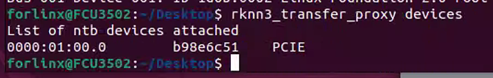
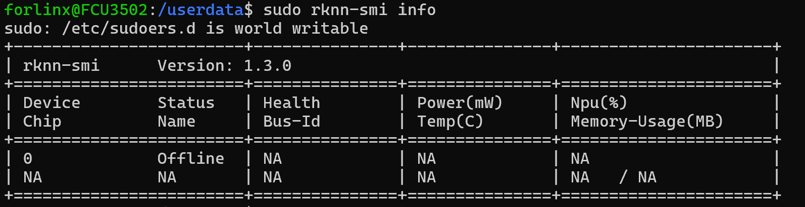
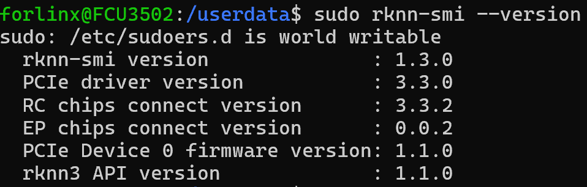

# Driver Update Guide

Document classification: □ Top secret □ Secret □ Internal information ■ Open

## Copyright

The copyright of this manual belongs to Baoding Folinx Embedded Technology Co., Ltd. Without the written permission of our company, no organizations or individuals have the right to copy, distribute, or reproduce any part of this manual in any form, and violators will be held legally responsible.
Forlinx adheres to copyrights of all graphics and texts used in all publications in original or license-free forms.
The drivers and utilities used for the components are subject to the copyrights of the respective manufacturers. The license conditions of the respective manufacturer are to be adhered to. Related license expenses for the operating system and applications should be calculated/declared separately by the related party or its representatives.

## 1. Driver Update
### 1.1 Querying the AI Accelerator
```plain
rknn3_transfer_proxy devices
```

This command queries the hardware AI accelerator on the PCIe interface; you can confirm it by its unique ID.



### 1.2 Updating the RKNN Driver
#### 1.2.1 Prerequisites

The FCU3502 ships with rknn3 driver version v1.0.0, which does not meet the minimum requirements for deploying large models such as Qwen v3.5, so you need to update the driver manually.

Attempting to deploy a large model on a system with an outdated version triggers a system error.

```plain
check ddr load addr request failed, service exit code is 234
```

Download the corresponding interface software installation package from the RK182X Software Materials\2-AI Accelerator Card SDK path on the internal FTP.

#### 1.2.2 Upgrade the Driver
Copy the software installation package to the device using FTP or similar software; we recommend creating a separate folder under /home/ for the operation.

```plain
mkdir/home/rknn3_installer
```

Change the permissions of the software installation package

```plain
chmod+xrknn3_rk182x_m2_v1.1.0_installer_arm64.tgz
```

Check user permissions. The following commands must be run as root.

```plain
cp rknn3_rk182x_m2_v1.1.0_installer_arm64.tgz /tmp/installer.tgz
cd /tmp && tar xzf installer.tgz && ./install.sh
```

After successful execution, we recommend rebooting once.

#### 1.2.3 Verifying the Driver
After rebooting, query from the command line; both the device hardware version and the API version have been successfully upgraded to 1.1.0.

```plain
rknn-smi info
```



```plain
rknn-smi --version
```



You can then continue deploying large models such as QWEN3.5.


