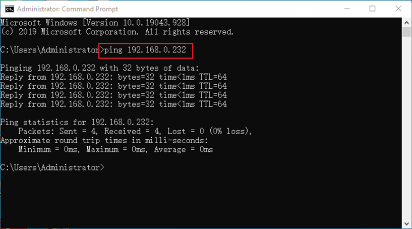

# FCU1501_User's Manual_FlBase22.04

Document classification: □ Top secret □ Secret □ Internal information ■ Open    

## Copyright

The copyright of this manual belongs to Baoding Folinx Embedded Technology Co., Ltd. Without the written permission of our company, no organizations or individuals have the right to copy, distribute, or reproduce any part of this manual in any form, and violators will be held legally responsible.

Forlinx adheres to copyrights of all graphics and texts used in all publications in original or license-free forms.  
The drivers and utilities used for the components are subject to the copyrights of the respective manufacturers. The license conditions of the respective manufacturer are to be adhered to. Related license expenses for the operating system and applications should be calculated/declared separately by the related party or its representatives.

## 1\. FCU1501 Product Overview

### 1.1 Product Description

The FCU1501 Embedded Control Unit is developed using the RK3506J processor, offering advantages such as high efficiency, high performance, and low cost. It operates at a main frequency up to 1.5GHz and supports SoM configurations extended to industrial-grade of 512MB/8GB. It comes in two default configurations: Basic and Extended. The Basic version integrates functional interfaces including Ethernet, 4G, WiFi, Bluetooth, RS485/RS232, and DI/DO. The Extended version further expands with additional RS485, CAN, and DI/DO interfaces, providing greater flexibility for customer-specific configurations. 

**Product Features:**

- Supports 9 ~ 36 V wide voltage input, with anti-reverse connection protection and overcurrent protection;

- Supports 10/100M Ethernet;

- Supports Wi-Fi; the module supports both STA and AP modes;

- Supports bluetooth;

- Supports USB;

- Supports all-network 4G modules;

- Supports RTC clock functionality;

- Expandable to support 8 x RS485, with isolated protection design;

- Expandable to support 2 x CAN, with isolated protection design;

- Expandable to support 8 x DI, dry contact inputs, with isolated protection design;

- Expandable to support 8 x DO, relay outputs, with contact ratings of 5A 250VAC and 5A 30VDC.


### 1.2 Application Areas

FCU1501 embedded control unit is applicable to energy management system, photovoltaic inverter, water, electricity and gas data acquisition; production process signal acquisition and data transmission of manufacturing and processing enterprises; MES (manufacturing execution system) signal acquisition and data transmission; environmental monitoring of hazardous chemical sites, atmospheric environmental monitoring signal acquisition and data transmission; Agricultural greenhouse environment monitoring signal acquisition, data transmission; breeding environment monitoring signal acquisition, data transmission; medicine, food storage environment monitoring signal acquisition, data transmission and other fields.

### 1.3 Software Parameter

The FCU1501 embedded control unit supports the basic version and the extended version by default. The extended version is only the function extension of the basic version. See the following table for the parameters of the basic function and the extended function.

#### 1.3.1 Basic Function

The functions of the FCU1501 Embedded Control Unit (Basic Edition) are as shown in the table below:

| Device| Description|
|----------|----------|
| Memory\&Storage Configuration:| eMMC: DDR3 512MB, eMMC 8GB|
| 4G (Optional)| Supported |
| DO| 2 x, electromagnetically isolated, contact rating: 5A 30VDC / 250VAC Interface: 3.81mm pitch green terminals |
| DI| 2 x, optocoupler quarantine, using 3.81mm pitch green terminal|
| RS232| 2 x, multiplexed with 2 x RS485, communication rate: 115200 bps|
| RS485| 4 x, including 2 x multiplexed with RS232, communication rate: 115200 bps|
| USB| 1 standard USB Type-A connector, available for programming|
| CAN| 1 x, CAN2.0 B, 1Mbps, isolation voltage 1.5 KV, Level 3 ESD protection|
| DEBUG| Type-C interface, USB-to-serial debugging|
| Ethernet| 2 x 10/100Mbps|
| Bluetooth and Wi-Fi| Wi-Fi: Supports 2.4G \& 5G, IEEE 802.11b/g/n 150Mbps WLAN  Bluetooth: 2.1/4.2/5.2  |
| Onboard Clock| Features a dedicated RTC chip and an on-board CR2032 battery|
| Buzzer| 1 x, equipped with a buzzer, customizable for user-defined functions|
| REST reset button| 1 x, one-click reset of network parameters, customizable|
| Indicator light 1| 4 x LED: 1 × PWR, 1 × RUN, 1 × ERR, and 1 x user-defined D1|
| Indicator light 2| 4 x LED: 3 x LED indicate 4G signal strength, and 1 x user-defined D2|
| 1 x SIM card slot| Self-ejection type, support for detection|
| Power supply| Main power input DC 12V, support DC 9V ~ 36V wide voltage input, with reverse connection protection and overcurrent protection|
| Working Environment| Humidity: 5% to 95%, non-condensing   Operating temperature: -40°C to +85°C (eMMC version)   Storage temperature: -40°C to +85°C|

#### 1.3.2 Extended Features

In addition to the above basic functions, the extended version of FCU1501 embedded control unit has the following additional function parameters:

| Device| Description|
|----------|----------|
| DO| 6 x, electromagnetically isolated, contact rating: 5A 250VAC, 5A 30VDC Interface: 3.81mm pitch green terminals |
| DI| 6 x, optocoupler quarantine, using 3.81mm pitch green terminal|
| RS485/RS232| 4 x, communication rate 115,200 bps|
| CAN| 1 x, CAN2.0 B, 1Mbps, isolation voltage 1.5 KV, Level 3 ESD protection|

### 1.4 Software Parameter

| Software Support | Description|
|----------|----------|
| OS| Linux-6.1.99|
| Filesystem| Forlinx Base22.04 （Ubuntu22.04）|
| GCC| 11.4.0|
| RS485/RS232| With 485 test examples|
| Network Protocols| TCP/IP, UDP,DHCP,TFTP,FTP, SSH, Web, Nginx, HTTP, IPtables, SQLite|
| Ethernet| 10M/100M auto-negotiating Ethernet, supports static and dynamic IP address allocation, and supports MAC address modification|
| Wi-Fi| Supports AP, STA modes|
| bluetooth| With test examples|
| 4G (Optional)|Supported|
| RTC| Supports automatic NTP time synchronisation and clock retention in the event of a power failure|
| Watchdog| Supports reset time setting|
| Buzzer| With test examples|
| Python| With test examples|
| QT| What We Provide:|

### 1.5 Enclosure Dimensions

#### 1.5.1 Enclosure Dimension Drawing

The figure below shows the enclosure dimension drawing of FCU1501.


**Note: The overall dimensions are 187mm × 151.84mm × 45mm (Length × Width × Height), including the thickness of the antenna base and snap fits.**

#### 1.5.2 Installation Method Schematic

Forlinx provides three optional installation methods for you: DIN rail mounting, hanger bracket mounting, and front-facing hanger bracket mounting. 

The specific operations are as follows:

DIN Rail Mounting: Use two M3×6 countersunk screws to secure the DIN rail.


Mounting Ear Installation: Use four M3×4 countersunk screws to secure the two mounting ears.


Front Mounting Ear Installation: Use four M3×4 countersunk screws to secure the two mounting ears.


**Note: After the terminal blocks are inserted, they may interfere with fixing the mounting ears. Therefore, install the mounting ears first, and then connect the terminal blocks.**

## 2. FCU1501 Function Description

### 2.1 Interface Diagram

The interface schematic of the FCU1501 embedded control unit is shown as follows. There are slight differences in the front interfaces between the basic version and the extended version of FCU1501, while the positions of the top-side interfaces are identical.

Top Interface Diagram


FCU1501 Top Interface Diagram

9–36V wide-voltage input, with a default input of DC 12V, including a protective earth (PE) terminal.

The terminal definitions are as follows:


9–36V wide-voltage output, with the output voltage the same as the input voltage; the default output is DC 12V；

The terminal definitions are as follows:


Bluetooth antenna position;

SIM card slot: Uses a Nano SIM card.

Wi-Fi antenna position;

RESET button: Used for one-click reset of network parameters (customizable).

4G Cat1 antenna port: Uses a small suction-cup antenna, cable length 3 m, antenna height 22 cm.

2 x DO, 3.81 mm pitch

The terminal definitions are as follows:


2 x D1, 3.81 mm pitch

The terminal definitions are as follows:


Front Interface Diagram


FCU1501 Front Interface Diagram (Basic Version)


FCU1501 Front Interface Diagram（Extended Version）

**Note: The Standard Version does not include the upper-row interfaces shown on the front panel of the Extended Version. Therefore, the Extended Version is used as the example in this document.**

6 x DI, 3.8 mm pitch

The terminal definitions are as follows:


3 x DO, 3.81 mm pitch 

The terminal definitions are as follows:


3 x DO, 3.81 mm pitch 

The terminal definitions are as follows:


1 x CAN, 3.81mm pitch;

The terminal definitions are as follows:


2 x RS485, 3.81 mm pitch

The terminal definitions are as follows:


2 x RS485, 3.81 mm pitch

The terminal definitions are as follows:


LED indicator:


1 x CAN, 3.81 mm pitch

The terminal definitions are as follows:


1 x multiplexed RS485/RS232, 3.81 mm pitch；

The terminal definitions are as follows:


1 x multiplexed RS485/RS232, 3.81 mm pitch；

The terminal definitions are as follows:


2 x RS485, 3.81 mm pitch

The terminal definitions are as follows:


Type-C interface for DEBUG.

Standard USB Type-A connector for firmware programming.

2 x 10M/100M adaptive Ethernet ports: ETH0 and ETH1;

The factory default IP address is ETH0: 192.168.0.232; ETH1: 192.168.1.232;

### 2.2 Power Supply

This product supports rated DC 12V input and features 9-36V wide-voltage input, with built-in reverse polarity protection. After the whole device is powered on, the power indicator light marked “POW” will be on.


The external power supply provides 9~36V wide-voltage output, whose voltage remains consistent with the input voltage, with a default output of DC 12V. As shown in the figure below:


### 2.3 User Login

FCU1501 supports two control methods for logging into the system: debug serial port and network.

#### 2.3.1 SSH Login

Connect a PC or laptop to the FCU1501 via an Ethernet cable, using the ETH1 port as the SSH login interface. The default IP address of FCU1501’s ETH0 upon power-on is 192.168.0.232, and the default IP address of ETH1 upon power-on is 192.168.1.232. Set the PC’s IP address to the 192.168.1.xx network segment. After a normal power-on, log in via SSH and enter commands to test basic functions and applications.

Default username: root; Password: no password.

Open a terminal tool (taking MobaXterm as an example), configure it as follows and click Open:


Click “OK”. When logging in, enter the username (root) — there is no default password.


#### 2.3.2 Debug Serial Port Login

To use this serial port for debugging, it is necessary to connect the TYPE-C interface cable, which is suitable for early R \& D and debugging. For on-site debugging and maintenance in the later stage, it is recommended to use the network login method. The username and password are the same as those used for SSH login.

The location of the DEBUG debug serial port is shown in the figure below:


#### 2.3.3 View System Logs

After the system starts, you can view the kernel startup information in /var/log/messages or use the dmesg command.

Using dmesg:

```plain
root@FCU1501:/# echo "3 4 1 7" > /proc/sys/kernel/printk  #Turn off RTW output
root@FCU1501:/# dmesg | less
[   10.527223] Booting Linux on physical CPU 0xf00
root@FCU1501:/# resize     #Adaptive terminal display
```

#### 2.3.4 Memory and Storage Space Distribution

The storage occupancy of FCU1501 (512MB RAM + 8GB eMMC) is as follows:

```plain
root@FCU1501:~# df –h
Filesystem      Size  Used Avail Use% Mounted on
/dev/root       2.9G  1.6G  1.1G  60% /
tmpfs           238M   20K  238M   1% /dev/shm
tmpfs            96M  3.6M   92M   4% /run
tmpfs           5.0M     0  5.0M   0% /run/lock
tmpfs           238M     0  238M   0% /tmp
tmpfs           238M  180K  238M   1% /var/log
/dev/mmcblk0p5  128M  4.3M  124M   4% /oem
/dev/mmcblk0p6  4.0G  308K  4.0G   1% /userdata    //The partition supports user read-write use.
tmpfs            48M     0   48M   0% /run/user/0
```

If you want to adjust the partition size, refer to Chapter 4 of the FCU1501 Embedded Control Unit Forlinx Base Application Update Manual V1.0-2026.04.11 to perform partition adjustment.

Memory occupancy distribution of FCU1501 (512MB + 8GB eMMC)

```plain
root@FCU1501:~# free -hm
               total        used        free      shared  buff/cache   available
Mem:           475Mi        71Mi       275Mi       3.0Mi       128Mi       389Mi
Swap:             0B          0B          0B
```

### 2.4 Querying Image Version Information

View device version information:

```plain
root@FCU1501:~# board-info.sh
System and Configuration Information:

SOC Type:              3506J
System Version:        Forlinx Base 22.04
Hostname:              FCU1501
Current System Time:   Thu Mar 26 14:54:06 CST 2026
System Uptime:         0 min
CPU Load:              1%
Memory Load:           15%


Watchdog:              Built-in watchdog supported


4G Module:             4G module detected
USB Drive:             No USB drive connected

-------------------------------------------------

CPU Information:

Number of Physical CPUs:  0
Number of Logical CPUs:   3
CPU Architecture:         armv7l

-------------------------------------------------

Memory Information:

               total        used        free      shared  buff/cache   available
Mem:             475          69         263           3         141         390
Swap:              0           0           0

-------------------------------------------------

IP Information:

System IP Addresses:
          eth0: 192.168.0.232
          eth1: 192.168.1.232
          wlan0:
          wlan1:
          usb0:

MAC Addresses:
          eth0: f2:2f:41:b4:4d:49
          eth1: fe:1a:07:86:1a:af
          wlan0: 84:fc:14:3a:a3:a9
          wlan1: 86:fc:14:3a:a3:a9
          usb0: ae:0c:29:a3:9b:6d

Gateway Address: 192.168.0.1

Routing Information:
Kernel IP routing table
Destination     Gateway         Genmask         Flags Metric Ref    Use Iface
0.0.0.0         192.168.0.1     0.0.0.0         UG    0      0        0 eth0
192.168.0.0     0.0.0.0         255.255.255.0   U     0      0        0 eth0
192.168.1.0     0.0.0.0         255.255.255.0   U     0      0        0 eth1

DNS Information:
nameserver 8.8.8.8
nameserver 114.114.114.114

-------------------------------------------------

Disk Usage:
Filesystem     Type   Size  Used Avail Use% Mounted on
/dev/root      ext4   2.9G  1.6G  1.1G  60% /
/dev/mmcblk0p5 ext4   128M  4.3M  124M   4% /oem
/dev/mmcblk0p6 ext4   4.0G  308K  4.0G   1% /userdata
-------------------------------------------------
=======================================
Build Time: 2026-03-25 18:34:01
=======================================
[Bsp Commits]
e0d82e948
[Kernel Commits]
dc4bb836d
[U-boot Commits]
4b0d11c
```

### 2.5 Frequency Modulation Function

**Note: The following example uses cpu0. In actual operation, the frequencies of cpu1 and cpu2 will change simultaneously.**

All cpufreq governor types supported in the current kernel.

```plain
root@FCU1501:/# cat /sys/devices/system/cpu/cpu0/cpufreq/scaling_available_governors
ondemand userspace performance
```

userspace indicates user mode, in which user programs are allowed to adjust the CPU frequency.

To view the current frequency levels supported by the CPU.

```plain
root@FCU1501:/# cat /sys/devices/system/cpu/cpu0/cpufreq/scaling_available_frequencies
600000 800000 1008000 1200000 1296000 1416000 1512000
```

Set to userspace mode and modify the frequency to 1200000.

```plain
root@FCU1501:/# echo userspace > /sys/devices/system/cpu/cpu0/cpufreq/scaling_governor
root@FCU1501:/# echo 1200000 > /sys/devices/system/cpu/cpu0/cpufreq/scaling_setspeed
```

To view the current frequency after modification.

```plain
root@FCU1501:/# cat /sys/devices/system/cpu/cpu0/cpufreq/cpuinfo_cur_freq
1200000
```

### 2.6 Temperature Reading Function

To view temperature values:

```plain
root@FCU1501:/# cat /sys/class/thermal/thermal_zone0/temp
39851
```

The temperature value is 39.9℃

### 2.7 Watchdog Function

The watchdog is a commonly used feature in embedded systems. The device node of the watchdog on OK3506-S/OK3506-C is /dev/watchdog.

Start the watchdog, set the reset timeout to 10 seconds, and feed the watchdog periodically so that the system will not restart.

```plain
root@FCU1501:/# fltest_watchdog -t 10 -c
Watchdog Ticking Away!
```

When using Ctrl+C to end the test program, feeding stops, and the watchdog remains open. After 10s, the system resets.

If you do not want a reset enter the command to close the watchdog within 10s after ending the program:

```plain
root@FCU1501:/# fltest_watchdog -d
Watchdog disabled.
```

Start the watchdog, set the reset timeout to 10 seconds, but do not feed it; the system will reboot after 10 seconds.

```plain
root@FCU1501:/# fltest_watchdog -t 10
Watchdog Ticking Away!
[   39.114587] watchdog: watchdog0: watchdog did not stop!
```

### 2.8 RTC Function

**Note: Ensure that a button battery is installed on the board and the battery voltage is normal.**

To perform the RTC test, the date and hwclock tools are used to set the system and hardware clocks. The device is then powered off and on to confirm that the system clock successfully synchronizes with the RTC upon reboot.

Set the time:

```plain
Root@FCU1501:/# date -s "2026-12-12 17:23:00"  // Set system software time
Mon Dec 12 17:23:00 UTC 2026
Root@FCU1501:/# hwclock -w  // Synchronize the current system software time to the hardware RTC clock
Root@FCU1501:/# hwclock -r  // Read and display the time stored in the hardware RTC clock
2026-12-12 17:23:09.758458+08:00
```

Then power off and power on the board. After entering the system, read the system time, and you can see that the time is synchronized.

```plain
root@FCU1501:/# date
Mon Dec 12 17:24:39 UTC 2026
```

### 2.9 System Indicator Lights

The FCU1501 is equipped with 8 system indicator lights, which are the 4G network light, power (PWR) light, system error (ERR) light, system operation (RUN) light, and two user-defined indicator lights (D1 and D2), as shown in the figure below:


The PWR (Power) indicator light serves as the power supply indicator for the system. It automatically turns on when power is supplied and turns off when power is cut.

The RUN indicator light has two functions:

Programming Indication: During programming, the RUN light stays on continuously. After programming is complete, it flashes every second (on and off once per second).

System Startup Indication: During system startup, the RUN light remains off. Once the system has fully started, the RUN light functions as a heartbeat indicator. After the system starts, the RUN light works as heartbeat light.

The ERR indicator is a system error indicator, with corresponding control interfaces provided.

The 4G indicator light indicates the status of the 4G network, with different levels corresponding to strong, moderate, and weak signal strength.

The D1 and D2 indicator lights can be customized for specific functions based on user requirements.

The detailed software and hardware correspondence for the above indicator lights is shown in the table below.

| Device Node Name| Hardware Identifier Name| Customization|
|----------|----------|----------|
| /sys/class/leds/err| ERR| Yes|
| /sys/class/leds/D1| D1| Yes|
| /sys/class/leds/D2| D2| Yes|

Taking D1 as an example, the switch state control is as follows:

```plain
root@FCU1501:/# echo 1 > /sys/class/leds/D1/brightness  # Turn on, the LED light illuminates
root@FCU1501:/# echo 0 > /sys/class/leds/D1/brightness  # Turn off, the LED light extinguishes
```

### 2.10 Ubuntu Emergency Mode

FCU1501 has emergency mode disabled by default. When the FCU1501 encounters issues such as configuration conflicts, file system errors, or storage device failures, the board will not enter emergency mode, but will force a startup instead. If you want to enable emergency mode, they can turn on the emergency mode service with the following command:

```plain
root@FCU1501:/# systemctl unmask emergency.target      # Enable emergency mode
```

### 2.11 RESET Button Input

#### 2.11.1 RESET One‑Key Network Parameter Recovery

RESET button: Used for one-click reset of network parameters, as shown in the red box in the figure below:


The reset button can directly reset the connection parameters of the network node. Using the evtest tool, you can get detailed information on various event types, including those triggered by keyboard presses, generated by mouse movements, and caused by touch-screen interactions, all of which can be accurately captured and displayed. You can also trigger custom events according to their application requirements.

The specific usage command is: evtest /dev/input/eventx (the event‑trigger node)

```plain
root@FCU1501:/# ls /dev/input/event*          // View all event nodes
/dev/input/event0         // Touchscreen touch event
/dev/input/event1         // RESET button
root@FCU1501:/# evtest  /dev/input/eventx     // evtest + event node to be tested
```

Using the event detection tool evtest to detect the RESET button event is shown below:

```plain
root@FCU1501:/# evtest  /dev/input/event1   //The RESET key event node is/dev/input/event1
Input driver version is 1.0.1
Input device ID: bus 0x19 vendor 0x1 product 0x1 version 0x100
Input device name: "adc-keys"
Supported events:
  Event type 0 (EV_SYN)
  Event type 1 (EV_KEY)
    Event code 114 (KEY_VOLUMEDOWN)
    Event code 115 (KEY_VOLUMEUP)
Properties:
Testing ... (interrupt to exit)
Event: time 1774490677.639161, type 1 (EV_KEY), code 114 (KEY_VOLUMEDOWN), value 1
Event: time 1774490677.639161, -------------- SYN_REPORT ------------
[  131.153576] rc.local[261]: recovery key pressed, setting eth0 IP to 192.168.0.232
[  131.164954] rc.local[261]: eth0 IP set successfully
[  131.166131] rc.local[261]: recovery key pressed, setting eth1 IP to 192.168.1.232
[  131.177441] rc.local[261]: eth1 IP set successfully
Event: time 1774490677.845844, type 1 (EV_KEY), code 114 (KEY_VOLUMEDOWN), value 0
Event: time 1774490677.845844, -------------- SYN_REPORT ------------
```

The evtest tool is integrated into the file system by default and can be used from any path. Specific file location:

```plain
root@FCU1501:/# find -name evtest
./usr/bin/evtest             // Exact path of the utility
```

#### 2.11.2 Disabling the Network Reset Function of the RESET Button

The one‑key network recovery function is implemented through a daemon process, which starts automatically by default. To disable this function, simply stop the daemon process. The specific operation command is as follows:

```plain
root@FCU1501:/# cat /etc/rc.local    //View system startup script
#!/bin/bash
#!/bin/bash
/userdata/autorun.sh &
/etc/init.d/instant_recovery.sh &    //Default background daemon process
exit 0
exit 0
```

**Note: The IP address set after this reset is only valid temporarily; it will restart to the default static IP address after a reboot. For instructions on configuring a static IP address, please refer to Section “2.22 Static IP Configuration”, to modify the system default IP address at startup.**

### 2.12 UART Usage and Example Program (Including Extended Version)

#### 2.12.1 Interface Description

The serial port connection structure is shown in the red box in the diagram.


#### 2.12.2 Correspondence Between Software and Hardware

| Device Node Name| Hardware Identifier Name|
|----------|----------|
| /dev/ttyS1| RS485\_1/RS232\_1|
| /dev/ttyS2| RS485\_2/RS232\_2|
| /dev/ttyS3| RS485\_3|
| /dev/ttyS4| RS485\_4|
| /dev/ttyCH343USB1| RS485\_5|
| /dev/ttyCH343USB2| RS485\_6|
| /dev/ttyCH343USB0| RS485\_7|
| /dev/ttyCH343USB3| RS485\_8|

#### 2.12.3 RS485 Test

This test method uses communication with a computer as an example. If you have a device with a dedicated RS485 interface, you can connect it directly for testing. In this case, we will use RS485\_2 as an example. If you need to test other RS485 interfaces, simply change the device node name to match the relevant interface.

Connect the RS232 to RS485 module to the RS485\_2 interface of the FCU1501. The connection method is as follows:


RS485\_2 will send a randomly generated test character stream to the PC at a baud rate of 115200. At the same time, manually send “Forlinx ok” from the PC terminal serial port assistant software to the FCU1501. Debug information is as follows:

```plain
root@FCU1501:~# fltest_uarttest -d /dev/ttyS2 -b 115200 -r &
[1] 1631
root@FCU1501:~# rx_0: forlinxforlinxforlinxforlinxforl
```

Serial port assistant software on the PC side: The data sent and received are as follows:


In the FCU1501 serial port, enter the following command to perform the UART transmission test:

```plain
root@FCU1501:~# fltest_uarttest -d /dev/ttyS2 -b 115200 -w 
[ 4750.838266] of_dma_request_slave_channel: dma-names property of node '/serial@ff0c0000' missing or empty
[ 4750.838403] dw-apb-uart ff0c0000.serial: failed to request DMA, use interrupt mode
tx_0: KaLKchczYFbc21YbhV5xYf2SotoVobK8
```

Check the received information on the PC side:


### 2.13 Ethernet Usage

FCU1501 supports 2 x 10M/100M adaptive Ethernet, which is RJ45 interface.

#### 2.13.1 Correspondence Between Software and Hardware

| Node Name| Hardware Identifier Name| IP address|
|----------|----------|----------|
| eth0| ETH0| 192.168.0.232|
| eth1| ETH1| 192.168.1.232|

#### 2.13.2 Network Card Test

Connect the network port of the PC to that of the FCU1501 via an Ethernet cable, and set the PC to a static IP address. The ETH1 interface of the FCU1501 uses the fixed IP 192.168.1.232, and the network service is enabled by default after system startup.

Type "ping 192.168.1.232" in the Windows Command Prompt window.

**Note: For Windows 10, right-click the Start icon and select “Command Prompt” from the pop-up menu to access the command window.**



A successful ping connection between the PC and FCU1501, followed by a valid SSH login, verifies the normal operation of the network adapter.

#### 2.13.3 IPv4 Basic Command Test

The examples in this section are tested under Forlinx Embedded’s internal network environment. Since actual network conditions may vary in deployment, perform configurations according to the specific on-site network environment.

The FCU1501 is equipped with two network adapters: eth0 and eth1. By default after power-on, the IP address of eth0 is 192.168.0.232, and the IP address of eth1 is 192.168.1.232.

Under the Linux system, use the ifconfig command to display or configure network devices, and use the ethtool utility to query and modify network adapter parameters.

```plain
root@FCU1501:/# ifconfig
```

Print information as follows:

```plain
eth0      Link encap:Ethernet  HWaddr D2:FB:8E:9A:FC:0A
          inet addr:192.168.0.232  Bcast:0.0.0.0  Mask:255.255.255.0
          UP BROADCAST MULTICAST  MTU:1500  Metric:1
          RX packets:0 errors:0 dropped:0 overruns:0 frame:0
          TX packets:0 errors:0 dropped:0 overruns:0 carrier:0
          collisions:0 txqueuelen:1000
          RX bytes:0 (0.0 B)  TX bytes:0 (0.0 B)
          Interrupt:53 Base address:0x6000

eth1      Link encap:Ethernet  HWaddr D6:26:B8:28:A1:8A
          inet addr:192.168.1.232  Bcast:0.0.0.0  Mask:255.255.255.0
          UP BROADCAST RUNNING MULTICAST  MTU:1500  Metric:1
          RX packets:991 errors:0 dropped:0 overruns:0 frame:0
          TX packets:641 errors:0 dropped:0 overruns:0 carrier:0
          collisions:0 txqueuelen:1000
          RX bytes:91711 (89.5 KiB)  TX bytes:27062 (26.4 KiB)
          Interrupt:55 Base address:0x8000

lo        Link encap:Local Loopback
          inet addr:127.0.0.1  Mask:255.0.0.0
          UP LOOPBACK RUNNING  MTU:65536  Metric:1
          RX packets:0 errors:0 dropped:0 overruns:0 frame:0
          TX packets:0 errors:0 dropped:0 overruns:0 carrier:0
          collisions:0 txqueuelen:1000
          RX bytes:0 (0.0 B)  TX bytes:0 (0.0 B)
```

Set the IP address, and configure eth0 with the IP 192.168.1.120.

```plain
root@FCU1501:/# ifconfig eth0 192.168.1.120 		        //Set ip
root@FCU1501:/# ifconfig eth0             		            //View the network status after setup
```

Print information as follows:

```plain
eth0      Link encap:Ethernet  HWaddr D2:FB:8E:9A:FC:0A
          inet addr:192.168.1.120  Bcast:192.168.1.255  Mask:255.255.255.0
          UP BROADCAST MULTICAST  MTU:1500  Metric:1
          RX packets:0 errors:0 dropped:0 overruns:0 frame:0
          TX packets:0 errors:0 dropped:0 overruns:0 carrier:0
          collisions:0 txqueuelen:1000
          RX bytes:0 (0.0 B)  TX bytes:0 (0.0 B)
          Interrupt:53 Base address:0x6000
```

The field inet addr:192.168.1.120 confirms the IP configuration is successful.

Set DNS

```plain
root@FCU1501:/# echo  nameserver 8.8.8.8  >>  /etc/resolv.conf        #Google DNS
root@FCU1501:/# echo nameserver 114.114.114.114 >>  /etc/resolv.conf  #Chinese DNS
```

Set dynamically assigned IP address.

If your control unit is connected to a router that supports DHCP automatic IP allocation, enter the following command in the super terminal:

```plain
root@FCU1501:/# udhcpc eth0
```

This command is used for dynamic IP acquisition. The wired network adapter of the Forlinx control unit is designated as eth0.

The DNS server information in the/etc/resolv. Conf file is automatically added.

Modify the MAC address

**Note: The following configuration method only takes effect temporarily in the terminal session.**

```plain
root@FCU1501:/#  ifconfig eth0 down
root@FCU1501:/# ifconfig eth0 hw ether 08:90:90:90:90:90  //eth0 mac设为08:90:90:90:90:90   
root@FCU1501:/# ifconfig eth0
eth0      Link encap:Ethernet  HWaddr 08:90:90:90:90:90
          inet addr:192.168.1.120  Bcast:192.168.1.255  Mask:255.255.255.0
          BROADCAST MULTICAST  MTU:1500  Metric:1
          RX packets:0 errors:0 dropped:0 overruns:0 frame:0
          TX packets:0 errors:0 dropped:0 overruns:0 carrier:0
          collisions:0 txqueuelen:1000
          RX bytes:0 (0.0 B)  TX bytes:0 (0.0 B)
          Interrupt:53 Base address:0x6000
```

The field HWaddr 08:90:90:90:90:90 confirms the MAC address modification is successful.

Set subnet mask

```plain
root@FCU1501:/# ifconfig eth0 netmask 255.255.255.0  //Set the eth0 subnet mask to 255.255.255.0
root@FCU1501:/# ifconfig eth0
```

Print information as follows:

```plain
eth0      Link encap:Ethernet  HWaddr 08:90:90:90:90:90
          inet addr:192.168.1.120  Bcast:192.168.1.255  Mask:255.255.255.0
          inet6 addr: fe80::64cd:22ff:fe3c:e6a2/64 Scope:Link
          UP BROADCAST RUNNING MULTICAST  MTU:1500  Metric:1
          RX packets:867 errors:0 dropped:0 overruns:0 frame:0
          TX packets:88 errors:0 dropped:0 overruns:0 carrier:0
          collisions:0 txqueuelen:1000
          RX bytes:87053 (85.0 KiB)  TX bytes:27156 (26.5 KiB)
```

Mask: 255.255.255.0 is the configured subnet mask.

Configure the broadcast address.

```plain
root@FCU1501:/# ifconfig eth0 broadcast 192.168.1.255	  //The eth0 broadcast address is set to 192.168.1.255
root@FCU1501:/# ifconfig eth0
```

Print information as follows:

```plain
eth0      Link encap:Ethernet  HWaddr 08:90:90:90:90:90
          inet addr:192.168.1.120  Bcast:192.168.1.255  Mask:255.255.255.0
          inet6 addr: fe80::64cd:22ff:fe3c:e6a2/64 Scope:Link
          UP BROADCAST RUNNING MULTICAST  MTU:1500  Metric:1
          RX packets:1063 errors:0 dropped:0 overruns:0 frame:0
          TX packets:91 errors:0 dropped:0 overruns:0 carrier:0
          collisions:0 txqueuelen:1000
          RX bytes:110722 (108.1 KiB)  TX bytes:28926 (28.2 KiB)
```

The field Bcast:192.168.1.255 confirms the broadcast address is set successfully.

Add/remove default gateway.

```plain
root@FCU1501:/# route add default gw 192.168.1.1 eth0	      // Add default gateway for eth0 network interface
root@FCU1501:/# route del default gw 192.168.1.1 eth0	      // Delete the specified default gateway for eth0 network interface
```

Enable or disable the network adapter.

```plain
root@FCU1501:/# ifconfig eth0 down					// Shut down the eth0 network interface
root@FCU1501:/# ifconfig eth0 up					// Start up the eth0 network interface
```

#### 2.13.4 Nginx Web Service

The FCU1501 natively supports the Nginx web server. Nginx is a high-efficiency web server running on the Linux platform, serving as a lightweight multi-task HTTP server that is highly suitable for embedded systems.

The Nginx service is set to start automatically upon system boot. Enter the IP address of the FCU1501 in the IE browser to access the web pages hosted on the control unit’s web server. The figure below is a screenshot of the page displayed in the Edge browser.


#### 2.13.5 Reverse Proxy Function

Based on the Nginx web service, the FCU1501 supports the reverse proxy feature. As a core component in modern network architectures, reverse proxy simplifies system design and enhances reliability by masking backend service details. The specific configuration modifications are as follows:

```plain
root@FCU1501:/# ls /etc/nginx/nginx.conf		// Locate and verify the path of the Nginx main configuration file
/etc/nginx/nginx.conf
root@FCU1501:/# vi /etc/nginx/nginx.conf        // Open and edit this Nginx configuration file with the vi editor
worker_processes  1;  // Configure Nginx to start 1 worker process (suitable for low-load embedded devices like FCU1501)
events {
    worker_connections  1024;  // Set the maximum number of concurrent connections that each worker process can handle to 1024
}
http {
    include       mime.types;  // Import the pre-defined MIME type mapping list to ensure correct identification of file types
    default_type  application/octet-stream;  // Specify the default MIME type as binary stream for unrecognized files
    sendfile        on;  // Enable the kernel-level sendfile system call to improve static file transmission efficiency
    keepalive_timeout  65;  // Set the maximum hold time of HTTP persistent connections to 65 seconds to reduce repeated connection overhead
    server {
        listen       80;  // Configure this virtual server to monitor the default HTTP port 80
        server_name  localhost;  // Bind the responding domain name to localhost, which only responds to requests targeting the local address
        # Static resource service rule
        location / {
            root   html;  // Set the root directory of static web files to the html directory under Nginx's working path
            index  index.html index.htm;  // Use index.html and index.htm as the default home page files in sequence
        }
        # Reverse proxy rule for backend API service
        location /api/ {
          proxy_pass         http://127.0.0.1:3000;  # Forward all requests prefixed with /api/ to the local backend service running on port 3000
          proxy_set_header   Host $host;              // Pass the original Host information of the client request to the backend service
          proxy_set_header   X-Real-IP $remote_addr;  // Write the client's real access IP into a custom header for the backend to obtain
          proxy_set_header   X-Forwarded-For $proxy_add_x_forwarded_for;  // Record all IPs that the request passes through in the proxy chain
          proxy_http_version 1.1;                    // Upgrade the proxy HTTP protocol to 1.1 to support long connection reuse
          proxy_set_header   Upgrade $http_upgrade;  // Forward the WebSocket protocol upgrade request header to ensure protocol compatibility
          proxy_set_header   Connection "upgrade";   // Add the Connection: upgrade header to complete the WebSocket handshake
} 
# Custom configuration for server error pages
        error_page   500 502 503 504  /50x.html;  // Redirect all 5xx series server internal errors to the 50x.html page
        location = /50x.html {
            root   html;  // Specify that the 50x.html error page is also stored in the static html directory
        }
    }
}
```

After completing the above configuration adjustments, when the backend service is running normally, accessing the URL 

[http://192.168.1.232/api/test](http://192.168.1.232/api/test，即请求被转发到http://127.0.0.1:3000/test，返回后端服务的响应。) in the browser will forward the request to http://127.0.0.1:3000/test, and return the response from the backend service.

#### 2.13.6 FTP Service

The system automatically starts the vsftpd service at boot, with its version being 3.0.2.

Use the FileZilla software on your PC to connect to the FTP service of the FCU1501. Enter the FTP login credentials in the box shown below (the default password for the root user is root). The connection uses the ETH2 interface by default.


Click “OK” on any pop-up prompt that appears during the process.

You will then gain access to the directory structure of the FCU1501.

### 2.14 Wi-Fi Usage Guide

After system startup, the Wi-Fi module is enabled and its driver is loaded by default. Ensure the Wi-Fi antenna is properly installed before proceeding.

#### 2.14.1 STA Test

2.14.1.1 Check if the Driver is Loaded

```plain
root@FCU1501:/# lsmod
Module                  Size  Used by    Not tainted
8733bu               2279993  0
rtk_btusb              54530  0
```

**Note: The appearance of the identifier 8733bu in the output confirms the module driver has been loaded. If 8733bu does not appear, the module is not loaded, and you need to verify that the kernel version matches the module version in the file system.**

2.14.1.2 Load the Module Manually

If 8733bu does not show up in the lsmod output, indicating the module is not loaded, use the following commands to load it manually:

```plain
root@FCU1501:/# insmod /lib/modules/$(uname -r)/kernel/drivers/net/wireless/realtek/rtl8733BU/8733bu.ko     /*加载8733bu*/
```

2.14.1.3 Configure Wi-Fi

**Note: -s specifies the name of the Wi-Fi hotspot; -p specifies the password. If there is no password, please enter -p NONE. This configuration applies to routers using WPA encryption.**

The connection output log is shown as follows:

```plain
root@FCU1501:/# fltest_wifi.sh -i wlan1 -s forlinx -p xxxx
wifi wlan1
ssid forlinx-wlan
pasw fl03123102650
waiting...
/usr/bin/fltest_wifi.sh: line 69: rfkill: command not found
wpa connecting ...
wpa connecting ...
wpa connecting ...
wpa connecting ...
udhcpc: started, v1.30.1
udhcpc: sending discover
udhcpc: sending select for 10.10.21.96
udhcpc: lease of 10.10.21.96 obtained, lease time 1800
/etc/udhcpc/default.script: Resetting default routes
SIOCDELRT: No such process
/etc/udhcpc/default.script: Adding DNS 119.29.29.29
/etc/udhcpc/default.script: Adding DNS 114.114.114.114
connect ok
```

2.14.1.4 Test Wi-Fi Connectivity

Test WiFi, ping domain name or IP.

```plain
root@FCU1501:/# ping www.baidu.com –I wlan1 -c 5
PING www.a.shifen.com (220.181.111.1): 56 data bytes
64 bytes from 220.181.111.1: icmp_seq=0 ttl=52 time=14.218 ms
64 bytes from 220.181.111.1: icmp_seq=1 ttl=52 time=14.694 ms
64 bytes from 220.181.111.1: icmp_seq=2 ttl=52 time=14.511 ms
64 bytes from 220.181.111.1: icmp_seq=3 ttl=52 time=20.600 ms
64 bytes from 220.181.111.1: icmp_seq=4 ttl=52 time=18.374 ms
--- www.a.shifen.com ping statistics ---
5 packets transmitted, 5 packets received, 0% packet loss
round-trip min/avg/max/stddev = 14.218/16.479/20.600/2.559 ms
```

Wi-Fi Signal

```plain
root@FCU1501:/# cat /proc/net/wireless | grep wlan1 | awk '{print $3}'       //Get signal strength 97..
root@FCU1501:/# cat /proc/net/wireless | grep wlan1 | awk '{print $4}'  //Obtain signal quality, single dBm
51..
root@FCU1501:/# cat /proc/net/wireless | grep wlan1 | awk '{print $5}' //Background noise of network port, in dBm
0.
```

2.14.1.5 Unload the Module

```plain
root@FCU1501:/# rmmod 8733bu
```

#### 2.14.2 AP Test

The default IP address pool for the generated Wi-Fi hotspot is 192.168.2.50 to 192.168.2.150, with the default gateway set to 192.168.2.1 and WPA-PSK encryption enabled. You can modify the IP pool, gateway and other configurations by editing the /etc/dnsmasq.conf file.

You can view or edit the configuration file /etc/hostapd-2.4g.conf to rename the hotspot to FCU1501\_WIFI\_2.4G\_AP and set its password to 12345678.

```plain
root@FCU1501:/# cat /etc/hostapd-2.4g.conf
interface=wlan0
driver=nl80211
channel=9
hw_mode=g

auth_algs=1
ieee80211n=1
ieee80211ac=1
wpa=2

ssid=FCU1501_WIFI_2.4G_AP                        //Hotspot name
wpa_passphrase=12345678                          //Hotspot password
wpa_key_mgmt=WPA-PSK
wpa_pairwise=CCMP
rsn_pairwise=CCMP
```

2.14.2.1 STA-AP Test

This example demonstrates hotspot connection via the wireless interface wlan1. After configuring the STA mode for wlan1, verify that wlan1 can access the external network (refer to the previous section “STA Mode Test” for verification methods), then follow the subsequent steps. Note: Close and restart the web application before running this test.

When operating in AP mode, devices such as mobile phones can connect directly to the module.

Configure the Ethernet IP address and set up the network firewall:

```plain
root@FCU1501:/# echo 1  >  /proc/sys/net/ipv4/ip_forward   //Turn on IP forwarding                                 
root@FCU1501:/# iptables -t nat -A POSTROUTING -o wlan1 -j MASQUERADE //Set forwarding rules
```

Set the Wi-Fi working mode and corresponding IP address.

```plain
root@FCU1501:/# ifconfig wlan0 up    //Enable Wi-Fi
root@FCU1501:/# ifconfig wlan0 192.168.2.1 netmask 255.255.255.0 //Set IP and Subnet Mask
```

Start the AP service.

```plain
hostapd -d /etc/hostapd-2.4g.conf &             //Encryption mode, user name, password and other settings
```

Mobile terminals such as smartphones can connect to the FCU1501’s AP hotspot via Wi-Fi to access the external network.

### 2.15 Bluetooth Usage Guide

Prior to the Bluetooth test, connect the dedicated Bluetooth antenna as shown in the red-boxed wiring diagram.


The carrier board Wi-Fi/Bluetooth combo module integrates full Bluetooth functionality. This section demonstrates point-to-point data transmission between a smartphone and the FCU1501 over Bluetooth.

#### 2.15.1 Bluetooth Configuration

```plain
root@FCU1501:/# bluetoothctl                     
[bluetooth]# power on
Changing power on succeeded
[bluetooth]# agent on
Agent is already registered
[bluetooth]# default-agent
Default agent request successful
[bluetooth]# discoverable on
hci0 new_settings: powered connectable bondable ssp br/edr le secure-conn 
hci0 new_settings: powered connectable discoverable bondable ssp br/edr le secure-conn 
Changing discoverable on succeeded
[CHG] Controller 88:49:2D:28:8D:E3 Discoverable: yes
```

#### 2.15.2 Passive Pairing

Enable Bluetooth on your smartphone and start a nearby device scan. A device named “FCU1501” (or “BlueZ 5.64”) will appear in the scan list, select it to start pairing.


The terminal will output the following prompt message, enter yes to confirm.

```plain
[CHG] Device FC:5B:8C:1A:A8:66 Connected: yes
Request confirmation
[agent] Confirm passkey 601078 (yes/no): yes
Authorize service
[agent] Authorize service 00001108-0000-1000-8000-00805f9b34fb (yes/no): yes
Authorize service
[agent] Authorize service 0000110d-0000-1000-8000-00805f9b34fb (yes/no): yes
[2526534850的Xiaomi 14]#
```

View and remove connected devices:

```plain
[bluetooth]# devices								//View connected Bluetooth device
Device FC:5B:8C:1A:A8:66 2526534850的Xiaomi 14
[bluetooth]# remove FC:5B:8C:1A:A8:66                 //Remove the device
[DEL] Device FC:5B:8C:1A:A8:66 2526534850的Xiaomi 14
Device has been removed
```

### 2.15.3 Active Pairing

As well as passive pairing, you can also send a request for active pairing from the terminal.

```plain
[bluetooth]# scan on	                                              //Search for discoverable Bluetooth
Discovery started
[CHG] Controller 88:49:2D:28:8D:E3 Discovering: yes
[CHG] Device C8:BC:9C:7D:CA:3C RSSI: -90
[NEW] Device 62:C8:63:D5:6C:56 62-C8-63-D5-6C-56
[CHG] Device C8:BC:9C:7D:CA:3C RSSI: -82
[NEW] Device 45:1D:13:02:0A:BA 45-1D-13-02-0A-BA
[NEW] Device 46:4D:03:3A:D3:FE 46-4D-03-3A-D3-FE
[CHG] Device 46:4D:03:3A:D3:FE RSSI: -84
[NEW] Device 55:0F:2A:2D:1B:AC 55-0F-2A-2D-1B-AC
[NEW] Device FC:5B:8C:1A:A8:66 2526534850的Xiaomi 14 
[bluetooth]# scan off		                                         //Stop searching
[bluetooth]# pair FC:5B:8C:1A:A8:66                                 //Paired bluetooth
Attempting to pair with FC:5B:8C:1A:A8:66
[CHG] Device FC:5B:8C:1A:A8:66 Connected: yes
Request confirmation
[agent] Confirm passkey 482007 (yes/no): yes 	                      //Confirm the key
```

#### 2.15.4 Receiving Files

After successful pairing, you can use the Bluetooth function on the smartphone to send files to the FCU1501.


All received files are saved in the /tmp directory.

#### 2.15.5 Sending Files

The following steps describe how to send a file to a smartphone:

```plain
root@FCU1501:/# fltest_obexctl.sh 		            //Enable obexctl
[NEW] Client /org/bluez/obex
[obex]# connect FC:5B:8C:1A:A8:66													//Connect to the Bluetooth MAC that needs to communicate
Attempting to connect to FC:5B:8C:1A:A8:66
[NEW] Session /org/bluez/obex/client/session0 [default]
[NEW] ObjectPush /org/bluez/obex/client/session0 
Connection successful
[14:99:3E:03:1B:E4]# send /tmp/1773477298236.png	        //Send files
```


Your mobile phone will receive a request to receive a file; tap “Accept” to transfer the file.

### 2.16 4G Usage Guide

The FCU1501 system supports 4G cellular networks. Actual 4G availability is subject to your specific purchase configuration. After power-on, the 4G module is powered on by default and its driver is preloaded. The positions of the external antenna interface and SIM card slot on the FCU1501 are shown in the following figure:

  
  


#### 2.16.1 4G Communication Test

Insert the SIM card properly, then run the lsusb command after powering on to check the USB device status.

```plain
root@FCU1501:/# lsusb
Bus 002 Device 003: ID 0bda:b733 Realtek Semiconductor Corp. 802.11n  WLAN Adapter
Bus 002 Device 004: ID 05e3:0747 Genesys Logic, Inc. USB Storage
Bus 002 Device 006: ID 2c7c:6002 Quectel Wireless Solutions Co., Ltd. EC800K-CN                                     //Corresponding node of 4G module
Bus 002 Device 002: ID 1a86:8091 QinHeng Electronics USB HUB
Bus 002 Device 001: ID 1d6b:0002 Linux Foundation 2.0 root hub
Bus 001 Device 001: ID 1d6b:0002 Linux Foundation 2.0 root hub
```

If the device node corresponding to the 4G module is not detected, use the following command to reset and reactivate the module:

```plain
root@FCU1501:/# echo 1 > /sys/class/leds/ec800k_4g_rst/brightness
```

Check the device node status under /dev.

```plain
root@FCU1501:/# ls /dev/ttyUSB*
/dev/ttyUSB0  /dev/ttyUSB1  /dev/ttyUSB2
```

After successful device identification, you can perform dial-up Internet access testing;

Use the quectelCM test application to perform dial-up Internet access.

```plain
root@FCU1501:/# quectelCM &
```

Part of the print information is as follows:

```plain
root@FCU1501:/# quectelCM &  
[1] 890
root@FCU1501:~# [05-09_10:57:04:267] QConnectManager_Linux_V1.6.7
[05-09_10:57:04:273] Find /sys/bus/usb/devices/2-1.4 idVendor=0x2c7c idProduct=0x6002, bus=0x002, dev=0x008
[05-09_10:57:04:274] Auto find qmichannel = /dev/ttyUSB1
[05-09_10:57:04:275] Auto find usbnet_adapter = usb0
[05-09_10:57:04:275] netcard driver = cdc_ether, driver version = 6.1.99+
[05-09_10:57:04:275] Modem works in ECM_RNDIS_NCM mode
[05-09_10:57:04:292] atc_fd = 7
[05-09_10:57:04:292] AT> ATE0Q0V1
[05-09_10:57:04:294] AT< OK
[05-09_10:57:05:295] AT> AT+QCFG="usbnet"
[05-09_10:57:05:298] AT< +QCFG: "usbnet",1 
. . . . . . 
[05-09_10:57:07:386] AT> AT+CGPADDR=1
[05-09_10:57:07:386] AT< +QNETDEVSTATUS: 1
[05-09_10:57:07:388] AT< +CGPADDR: 1,"100.99.7.168"
[05-09_10:57:07:389] AT< OK
[05-09_10:57:07:389] requestGetIPAddress 100.99.7.168
[05-09_10:57:07:389] AT> at+cops?
[05-09_10:57:07:391] AT< +COPS: 0,2,"46011",7
[05-09_10:57:07:391] AT< OK
[05-09_10:57:07:391] AT> at+qeng="servingcell"
[05-09_10:57:07:396] AT< +QENG: "servingcell","NOCONN","LTE","FDD",460,11,22FB412,9,1650,3,5,5,1680,-105,-10,-75,3,14
[05-09_10:57:07:397] AT< OK
[05-09_10:57:07:397] AT> AT+QNETDEVCTL?
[05-09_10:57:07:399] AT< +QNETDEVCTL: 1,1,1,1
[05-09_10:57:07:399] AT< OK
[05-09_10:57:07:399] AT> AT+CGACT?
[05-09_10:57:07:402] AT< +CGACT: 1,1
[05-09_10:57:07:402] AT< OK
[05-09_10:57:07:403] ip link set dev usb0 up
[05-09_10:57:07:425] busybox udhcpc -f -n -q -t 5 -i usb0
udhcpc: started, v1.30.1
udhcpc: sending discover
udhcpc: sending select for 100.99.7.168
udhcpc: lease of 100.99.7.168 obtained, lease time 86400
. . . . . .
```

View the node IP.

```plain
root@FCU1501:/# ifconfig usb0
usb0: flags=4163<UP,BROADCAST,RUNNING,MULTICAST>  mtu 1500
        inet 100.99.7.168  netmask 255.0.0.0  broadcast 100.255.255.255
        inet6 fe80::ac0c:29ff:fea3:9b6d  prefixlen 64  scopeid 0x20<link>
        ether ae:0c:29:a3:9b:6d  txqueuelen 1000  (Ethernet)
        RX packets 73  bytes 7618 (7.6 KB)
        RX errors 0  dropped 0  overruns 0  frame 0
        TX packets 137  bytes 13604 (13.6 KB)
        TX errors 0  dropped 0 overruns 0  carrier 0  collisions 0
```

Test network connectivity.

```plain
root@FCU1501:/# ping www.baidu.com -I usb0 –c 5
PING www.baidu.com(240e:83:205:1cd:0:ff:b0b8:dee9) from 240e:440:5218:709:9ffe:7c27:324b:6d4b usb0: 56 data bytes
64 bytes from 240e:83:205:1cd:0:ff:b0b8:dee9: icmp_seq=1 ttl=53 time=55.4 ms
64 bytes from 240e:83:205:1cd:0:ff:b0b8:dee9: icmp_seq=2 ttl=53 time=36.4 ms
64 bytes from 240e:83:205:1cd:0:ff:b0b8:dee9: icmp_seq=3 ttl=53 time=43.9 ms
64 bytes from 240e:83:205:1cd:0:ff:b0b8:dee9: icmp_seq=4 ttl=53 time=67.9 ms
64 bytes from 240e:83:205:1cd:0:ff:b0b8:dee9: icmp_seq=5 ttl=53 time=44.0 ms
--- www.baidu.com ping statistics ---
5 packets transmitted, 5 received, 0% packet loss, time 8497ms
rtt min/avg/max/mdev = 36.386/49.535/67.939/11.026 ms
```

#### 2.16.2 4G Communication Daemon

The 4G communication daemon application is integrated into the file system in the form of the mobilemgmt image. For full details, please refer to the document: Application Guide for 4G Daemon Process under Linux\_V2.0\_2025.10.23.

You can run the commands below for testing, which can also detect the SIM card status and signal strength at the same time.

```plain
root@FCU1501:/# mobilemgmt
start running mobilemgmt version is ver07.005 ... ...
path=/sys/bus/usb/devices/2-1.1:1.0
idVendor=0x2c7c idProduct=0x6002
atIntf = 3
[01-01_01:56:00:842] Auto find qmichannel = /dev/ttyUSB1
[01-01_01:56:00:842] Auto find usbnet_adapter = usb0
[01-01_01:56:00:842] netcard driver = cdc_ether, driver version = 6.1.99+
The module was loaded normally after 5 seconds
[01-01_01:56:01:043] Modem works in ECM_RNDIS_NCM mode
set done!
[01-01_01:56:01:045] atc_fd = 10
no sim card,we can do nothing!!!               #It is detected that no SIM card is inserted
^C[01-01_01:56:02:349] at_close
[01-01_01:56:02:350] atc_read_thread exit
root@FCU1501:/#
```

### 2.17 Database Usage

The on-board SQLite database version is 3.37.2. The test instructions are as follows:

```plain
root@FCU1501:/# sqlite3
SQLite version 3.37.2 2022-01-06 13:25:41 
Enter ".help" for usage hints.
Connected to a transient in-memory database.
Use ".open FILENAME" to reopen on a persistent database.
sqlite> create table tbl1 (one varchar(10), two smallint);
sqlite> insert into tbl1 values('hello!',10);
sqlite> insert into tbl1 values('goodbye', 20);
sqlite> select * from tbl1;
hello!|10
goodbye|20
sqlite> .quit
```

It can be seen from the above that database creation, reading and writing work normally.

### 2.18 DO/DI Usage (Including Extended Version)

#### 2.18.1 Interface Description


#### 2.18.2 Correspondence Between Software and Hardware

| Device Node Name| Hardware Identifier Name|
|----------|----------|
| /sys/class/leds/do0| DO1|
| /sys/class/leds/do1| DO2|
| /sys/class/leds/do2| DO3|
| /sys/class/leds/do3| DO4|
| /sys/class/leds/do4| DO5|
| /sys/class/leds/do5| DO6|
| /sys/class/leds/do6| DO7|
| /sys/class/leds/do7| DO8|
| /dev/gpio\_input\_0| DI1|
| /dev/gpio\_input\_1| DI2|
| /dev/gpio\_input\_2| DI3|
| /dev/gpio\_input\_3| DI4|
| /dev/gpio\_input\_4| DI5|
| /dev/gpio\_input\_5| DI6|
| /dev/gpio\_input\_6| DI7|
| /dev/gpio\_input\_7| DI8|

#### 2.18.3 DO Test

Turn on and off DO1 to DO8. Taking DO1 as an example, the operation is as follows:

```plain
root@FCU1501:/# echo 1 > /sys/class/leds/do0/brightness #on 
root@FCU1501:/# echo 0 > /sys/class/leds/do0/brightness #off
```

#### 2.18.4 DI Test

The test is performed through nodes /dev/gpio\_input\_0 to /dev/gpio\_input\_7. Taking DI-3 as an example, physically connect DIO-3 to DI3, then enter the following command:

```plain
root@FCU1501:/# ls /dev/gpio_input_*
/dev/gpio_input_0  /dev/gpio_input_2  /dev/gpio_input_4  /dev/gpio_input_6
/dev/gpio_input_1  /dev/gpio_input_3  /dev/gpio_input_5  /dev/gpio_input_7
root@FCU1501:/#
root@FCU1501:/# echo 1 > /sys/class/leds/do2/brightness
root@FCU1501:/# cat /sys/class/gpio-input//gpio_input_2/state
0
root@FCU1501:/# echo 0 > /sys/class/leds/do2/brightness
root@FCU1501:/# cat /sys/class/gpio-input//gpio_input_2/state
1
root@FCU1501:/#
```

### 2.19 CAN Usage (Including Extended Version)

#### 2.19.1 Interface Description

FCU1501 provides two CAN interfaces, taking CAN2 as an example as shown below.

| Schematic Diagram| Description|
|----------|----------|
| |

#### 2.19.2 Correspondence Between Software and Hardware

| Device Node Name| Hardware Identifier Name|
|----------|----------|
| CAN1| can0|
| CAN2| can1|

#### 2.19.3 CAN Test

Configure CAN services as follows to view CAN network devices:

```plain
root@FCU1501:/# ifconfig -a
can0      Link encap:UNSPEC  HWaddr 00-00-00-00-00-00-00-00-00-00-00-00-00-00-00-00
          NOARP  MTU:16  Metric:1
          RX packets:0 errors:0 dropped:0 overruns:0 frame:0
          TX packets:0 errors:0 dropped:0 overruns:0 carrier:0
          collisions:0 txqueuelen:10
          RX bytes:0 (0.0 B)  TX bytes:0 (0.0 B)
          Interrupt:51
can1      Link encap:UNSPEC  HWaddr 00-00-00-00-00-00-00-00-00-00-00-00-00-00-00-00
          NOARP  MTU:16  Metric:1
          RX packets:0 errors:0 dropped:0 overruns:0 frame:0
          TX packets:0 errors:0 dropped:0 overruns:0 carrier:0
          collisions:0 txqueuelen:10
          RX bytes:0 (0.0 B)  TX bytes:0 (0.0 B)
          Interrupt:52
```

Set parameters for CAN0 and CAN1

```plain
root@FCU1501:/# ip link set can0 down
root@FCU1501:/# ip link set can1 down
root@FCU1501:/# ip link set can0 type can bitrate 1000000 sample-point 0.8 dbitrate 2000000 sample-point 0.8 fd on
root@FCU1501:/# ip link set can1 type can bitrate 1000000 sample-point 0.8 dbitrate 2000000 sample-point 0.8 fd on
```

Set the baud rate of CAN0 and CAN1 to 500000

Open CAN0, CAN1

```plain
root@FCU1501:/# ip link set can0 up
root@FCU1501:/# echo 4096 > /sys/class/net/can0/tx_queue_len
root@FCU1501:/# ip link set can1 up
root@FCU1501:/# echo 4096 > /sys/class/net/can1/tx_queue_len
```

The client sends data and the server receives data:

When the CAN0 device acts as the server (the server must first execute the following command):

```plain
root@FCU1501:/# candump can0 &
```

When device CAN1 acts as the client (the client sends data):

```plain
root@FCU1501:/# cansend can1 1F334455#1122334455667788
can0  1F334455   [8]  11 22 33 44 55 66 77 88
```

### 2.20 Buzzer Usage

FCU1501 comes with a built-in buzzer, allowing users to customize prompt functions; the specific test process is as follows:

```plain
root@FCU1501:/# echo 1 > /sys/class/leds/beeper/brightness  #Turn on the beep
root@FCU1501:/# echo 0 > /sys/class/leds/beeper/brightness  #Turn off
```

#### 2.21 System Boot Auto-start Function

The system starts the application automatically when it is powered on, which is mainly managed by the systemd service.

```plain
root@FCU1501:/# ls /etc/systemd/system/multi-user.target.wants/ #List of power on services
containerd.service    mosquitto.service    pulseaudio.service  strongswan-starter.service    wpa_supplicant.service    cron.service          networkd-dispatcher.service    rc-local.service    systemd-networkd.service
dmesg.service    nginx.service    remote-fs.target    unattended-upgrades.service
dnsmasq.service       ntp.service    rsyslog.service    vsftpd.service
e2scrub_reap.service    obex.service    ssh.service    web.service
```

You can set a service to disable auto-start on boot as needed. For example, to disable nginx auto-start:

```plain
root@FCU1501:/# systemctl disable nginx.service  #Turn off nginx boot
Synchronizing state of nginx.service with SysV service script with /lib/systemd/systemd-sysv-install.
Executing: /lib/systemd/systemd-sysv-install disable nginx
Removed /etc/systemd/system/multi-user.target.wants/nginx.service.
```

### 2.22 User-defined Auto-start Function

The custom boot auto-start script is /userdate/autorun.sh, where you can add commands that need to be executed on system boot.

Assuming you need to automatically run the 4G dial-up script on boot: note that the 4G module requires a certain initialization time, and actual tests show that dial-up should be performed 3 to 5 seconds after boot. Add the following content to /userdate/autorun.sh:

```plain
sleep 5
quectelCM &         //4G dialup script starts running in the background
exit 0    /*Add above exit*/
```

For the convenience of deployment, you can directly add the configurations of /userdate/autorun.sh to the file system.

### 2.23 Replacing Software Repository

FCU1501 uses the official Ubuntu 22.04 repository by default. If you want to replace the repository, you can modify it in /etc/apt/sources.list.

### 2.24 Static IP Configuration

The network nodes of FCU1501 include wired connections eth0 and eth1, and wireless connections wlan0 and wlan1. By factory default, eth0 and eth1 are set with fixed IP addresses. You can customize specific addresses according to actual needs for convenience.

Open /etc/systemd/network/10-eth0.network, modify the configuration to set eth0 as a static IP interface.

```plain
[Match]
Name=eth0

[Network]
Address=192.168.0.232/24
Gateway=192.168.0.1
```

Configure DNS. Since the resolved service is disabled by default in the current file system, the DNS settings in 10-eth0.network will be ignored. It is recommended to use /etc/resolv.conf for global DNS management:

```plain
root@FCU1501:/# echo nameserver 8.8.8.8 > /etc/resolv.conf
```

Restart

```plain
root@FCU1501:/# reboot
```

### 2.25 eMMC Lifespan Detection Tool

The FCU1501 file system has a built-in eMMC lifespan detection tool, which can be used to check the eMMC health status. For the tool usage instructions, please refer to EMMC Health Monitoring Tool User Guide. An example of usage is as follows:

```plain
root@FCU1501:~# mmcinfo /dev/mmcblk0 -y 10 -debug
root@FCU1501:~# cat /var/mmc_guard/health.info
Forlinx EMMC Health Check Tool
Capacity                  : 7456 ,(unit=1M)
Average erase count       : [ 21 / 3000 ]
Maximum erase count       : [ 23 / 3000 ]
Minimum erase count       : [ 1 / 3000 ]
Host total write          : 25.500000 ,(unit=1G)
Host total read           : 658.125000 ,(unit=1G)
Bad block count           : 0
Rewrite count             : 394
Power-on count            : 36
Write amplification       : 5.396691
Disk write capacity       : 3642.857143, (unit=1G)
last check interval write : 25.500000, (unit=1G)
Check statistics          : [ 0 / 0 ]
```

### 2.26 Python Language Support

The FCU1501 file system comes with built-in support for Python 3.11. The specific usage is as follows:

```plain
root@FCU1501:/# python3
Python 3.10.12 (main, Mar  3 2026, 11:56:32) [GCC 11.4.0] on linux
Type "help", "copyright", "credits" or "license" for more information.
>>> print("Hello World from Python 3.11!")
Hello World from Python 3.11!
>>> exit()
```

### 2.27 QT Libraries

The FCU1501 file system has built-in support libraries for QT5. The specific view operation is as follows:

```plain
​```plain
root@FCU1501:/# find -name qt5  // Search the entire system recursively for all paths named "qt5", and return the following 4 matching directories
./usr/include/arm-linux-gnueabihf/qt5  // Qt5 header file directory for 32-bit ARM hard-float architecture, storing all Qt component development header files
./usr/share/qt5  // Qt5 public resource directory, holding cross-architecture shared data such as documentation, configuration templates and auxiliary scripts
./usr/lib/qt5  // General Qt5 functional component directory under the system lib path
./usr/lib/arm-linux-gnueabihf/qt5  // Core running resource directory of Qt5 for 32-bit ARM hard-float architecture
root@FCU1501:/# ls /usr/lib/arm-linux-gnueabihf/qt5/plugins/  // List all subdirectories under the Qt5 plug-in storage path for ARM architecture, which correspond to different functional plug-in categories
bearer            # Network connection management plug-ins (support functions such as VPN and mobile network state management)
iconengines       # Icon rendering engine plug-ins, used to load and render special icon formats such as SVG
platforminputcontexts  # Input method platform plug-ins, responsible for integrating different input method frameworks into the Qt GUI program
generic           # General function plug-ins, including print support, clipboard extension and other universal functional modules
imageformats      # Image format decoding and encoding plug-ins, providing Qt with the ability to parse formats such as JPEG, PNG and GIF
platforms         # Platform integration plug-ins, which are the core modules for Qt to adapt to different window systems such as XCB, Wayland and eglfs
printsupport      # Print function support plug-ins, providing Qt programs with print preview, printer discovery and print task sending capabilities
xcbglintegrations  # XCB platform OpenGL graphic rendering integration plug-ins, optimized for hardware acceleration graphics under X11
egldeviceintegrations         # EGL device platform integration plug-ins, adapted for the hardware rendering environment of embedded no-display (headless) devices
platformthemes         # Platform theme plug-ins, used to adapt the Qt interface to the system native theme style and style configuration
sqldrivers         # Database driver plug-ins, providing Qt SQL modules with access capabilities for different databases such as SQLite and MySQL
​```
```

### 2.28 MQTT

The FCU1501 file system has built-in MQTT support. The specific view operation is as follows:

```plain
root@FCU1501:/# mosquitto --help
mosquitto version 2.0.11
mosquitto is an MQTT v5.0/v3.1.1/v3.1 broker.
Usage: mosquitto [-c config_file] [-d] [-h] [-p port]

 -c : specify the broker config file.
 -d : put the broker into the background after starting.
 -h : display this help.
 -p : start the broker listening on the specified port.
      Not recommended in conjunction with the -c option.
 -v : verbose mode - enable all logging types. This overrides
      any logging options given in the config file.

See https://mosquitto.org/ for more information.
root@FCU1501:/# ls /usr/bin/ | grep mosquitto   #所支持MQTT客户端工具
mosquitto_ctrl
mosquitto_passwd
mosquitto_pub
mosquitto_rr
mosquitto_sub
```

### 2.29 TUN

The FCU1501 kernel has TUN support enabled. The specific view operation is as follows:

Create a TUN device;

```plain
root@FCU1501:/# ip tuntap add dev tun0 mode tun user root
```

Configure IP address (point-to-point network segment, 30-bit subnet mask contains only 2 usable IP addresses);

```plain
root@FCU1501:/# ip addr add 10.0.0.1/30 dev tun0
```

Enable the device;

```plain
root@FCU1501:/# ip link set dev tun0 up
```

Add a static route: point the target internal network segment to the TUN device;

```plain
root@FCU1501:/# ip route add 192.168.2.0/24 dev tun0
```

Verify the device status.

```plain
root@FCU1501:/# ip link show tun0
9: tun0: <NO-CARRIER,POINTOPOINT,MULTICAST,NOARP,UP> mtu 1500 qdisc pfifo_fast state DOWN mode DEFAULT group default qlen 500
link/none
root@FCU1501:/# ip route show
default via 192.168.0.1 dev eth0 linkdown
10.0.0.0/30 dev tun0 proto kernel scope link src 10.0.0.1 linkdown
192.168.0.0/24 dev eth0 proto kernel scope link src 192.168.0.232 linkdown
192.168.1.0/24 dev eth1 proto kernel scope link src 192.168.1.232 linkdown
```

### 2.30 NTP Service

NTP service is enabled on FCU1501. The specific view operation is as follows:

```plain
root@FCU1501:/# ps -aux | grep ntp
ntp       353  0.0  0.9   7556  4728 ?        Ssl  11:39   0:02 /usr/sbin/ntpd -p /var/run/ntpd.pid -g -u 102:103
root     1245  0.0  0.2   2596  1340 ttyFIQ0  S+   13:49   0:00 grep --color=auto ntp
```

### 2.31 IPtables

The FCU1501 file system is integrated with the Iptables tool. The specific view operation is as follows:

```plain
root@FCU1501:/# iptables -V
iptables v1.8.7 (nf_tables)
```

### 2.32 Telnet

The FCU1501 file system is integrated with the Telnet tool. The specific view operation is as follows:

```plain
root@FCU1501:/# which telnet
/usr/bin/telnet
root@FCU1501:/# telnet
telnet>
root@FCU1501:/# telnetd -V
telnetd (GNU inetutils) 2.2
Copyright (C) 2021 Free Software Foundation, Inc.
License GPLv3+: GNU GPL version 3 or later <https://gnu.org/licenses/gpl.html>.
This is free software: you are free to change and redistribute it.
There is NO WARRANTY, to the extent permitted by law.

Written by many authors.
```

### 2.33 Docker 

The FCU1501 file system is integrated with the Docker tool, but Docker does not start automatically on boot by default. The specific view operation is as follows:

```plain
root@FCU1501:/# systemctl start docker    # Start the Docker service
root@FCU1501:/# systemctl enable docker    # Optional: configure Docker to start on system boot
Synchronizing state of docker.service with SysV service script with /lib/systemd/systemd-sysv-install.
Executing: /lib/systemd/systemd-sysv-install enable docker
Created symlink /etc/systemd/system/multi-user.target.wants/docker.service → /lib/systemd/system/docker.service.
root@FCU1501:/# systemctl enable docker.socket    # Optional: configure Docker to be triggered for startup via commands
root@FCU1501:/# docker --version    # Check Docker version
Docker version 29.3.0, build 5927d80
root/FCU1501:/# docker pull registry.cn-hangzhou.aliyuncs.com/acs/busybox:latest
latest: Pulling from acs/busybox    # Pull the image for testing
Digest: sha256:5acba83a746c7608ed544dc1533b87c737a0b0fb730301639a0179f9344b1678
Status: Image is up to date for registry.cn-hangzhou.aliyuncs.com/acs/busybox:latest
registry.cn-hangzhou.aliyuncs.com/acs/busybox:latest
root@FCU1501:/# docker images
REPOSITORY                                             TAG       IMAGE ID       CREATED        SIZE
registry.cn-hangzhou.aliyuncs.com/acs/busybox:latest   latest     5acba83a746c   <timestamp>    1.8MB
```

### 2.34 Crond

The FCU1501 file system is integrated with the Crond tool. The specific view operation is as follows:

```plain
root@FCU1501:/# ps -ef | grep -i cron  // The crond process has already been started
root      221    1  0 08:27 ?        00:00:00 /usr/sbin/cron -f -P
root     2811  578  0 11:51 ttyFIQ0  00:00:00 grep --color=auto -i cron  
root@FCU1501:/# crontab -e  // Execute the command to open the editor
* * * * * date >> /tmp/cron_test.log  // Add a cron job to have the system log the current date and time every minute
// Wait a minute or two, then check the time recorded
root@FCU1501:/# cat /tmp/cron_test.log
Thu Jan  1 01:38:01 UTC 1970
Thu Jan  1 01:39:01 UTC 1970
```

### 2.35 lrzsz

The FCU1501 file system is integrated with the lrzsz tool. The specific view operation is as follows:

**Note: Before testing, make sure the terminal emulation software you use supports the Zmodem protocol! This test uses MobaXterm.**

```plain
root@FCU1501:/# which rz sz
/usr/bin/rz
/usr/bin/sz
# Test sz
root@FCU1501:/# sz -be /tmp/cron_test.log
▒lrz waiting to receive.*CD@@@AKa▒Dcron_test.log@261 0 14331 0 0 33188@k+[▒s

Receiving: cron_test.log
*CJ@@@@▒▒▒▒Thu Jan  1 01:38:01 UTC 1970JThu Jan  1 01:39:01 UTC 1970JThu Jan  1 01:40:01 UTC 1970JThu Jan  1 01:41:01 UTC 1970JThu Jan  1 01:42:01 UTC 1970JThu Jan  1 01:43:01 UTC 1970JThu Jan  1 01:44:01 UTCDownloading: 100% kBytes received:      0/     0   kBPS:3                    \▒▒
▒OOroot@FCU1501:/#
Transfer complete     // Transfer finished

# Test rz
root@FCU1501:/# cd /tmp/    // Go to the location where you want to save the file
root@FCU1501:/tmp# rz -be   // Execute the command to prepare to receive the file, and then send the file
▒Sending: md5.txt6ive.**B0100000063f694
▒*B0900000000a87c
Bytes Sent:     52   BPS:37
▒*B0800000000022d
Transfer complete
root@FCU1501:/tmp# ls
cron  cron.cnlByD  cron_test.log  dbus  dhcpd.leases  dhcpd.leases~  dnsmasq.leases  md5.txt  nginx
```


### 2.36 Ntpdate

ntpdate is a command-line tool for synchronizing the system time over the network. It can connect to a time server and correct the local time. Ensure the device is connected to the network before testing. The FCU1501 file system is integrated with the ntpdate tool. The specific view operation is as follows:

```plain
# Test whether you can connect to the time server. If you want to synchronize, just do not use the -q option.
root@FCU1501:/# ntpdate -q ntp.aliyun.com
server 203.107.6.88, stratum 2, offset -0.003628, delay 0.04810
 2 Feb 06:08:18 ntpdate[2688]: adjust time server 203.107.6.88 offset -0.003628 sec
```

### 2.37 Curl

curl is a powerful command-line tool mainly used for data transmission. The FCU1501 file system is integrated with the curl tool. The specific view operation is as follows:

```plain
root@FCU1501:/# curl -V
curl 7.81.0 (arm-unknown-linux-gnueabihf) libcurl/7.81.0 OpenSSL/3.0.2 zlib/1.2.11 brotli/1.0.9 zstd/1.4.8 libidn2/2.3.2 libpsl/0.21.0 (+libidn2/2.3.2) libssh/0.9.6/openssl/zlib nghttp2/1.43.0 librtmp/2.3 OpenLDAP/2.5.20
Release-Date: 2022-01-05
Protocols: dict file ftp ftps gopher gophers http https imap imaps ldap ldaps mqtt pop3 pop3s rtmp rtsp scp sftp smb smbs smtp smtps telnet tftp
Features: alt-svc AsynchDNS brotli GSS-API HSTS HTTP2 HTTPS-proxy IDN IPv6 Kerberos Largefile libz NTLM NTLM_WB PSL SPNEGO SSL TLS-SRP UnixSockets zstd
# Test the server connection
root@FCU1501:/# curl -I http://www.forlinx.com
HTTP/1.1 301 Moved Permanently
Server: nginx
Date: Mon, 02 Feb 2026 06:14:34 GMT
Content-Type: text/html
Content-Length: 162
Connection: keep-alive
Location: https://www.forlinx.com/
```

### 2.38 Tcpdump

tcpdump is a powerful network packet capture tool that can capture network packets for subsequent analysis with Wireshark. The FCU1501 file system is integrated with the tcpdump tool. The specific view operation is as follows:

```plain
# First of all, the background is set to capture data packets, with a time limit of 10 seconds.
root@FCU1501:/# timeout 10 tcpdump -i eth0 -w /userdata/test_capture.pcap &
[1] 3209
root@FCU1501:~# tcpdump: listening on eth0, link-type EN10MB (Ethernet), snapshot length 262144 bytes

# Generating network data
root@FCU1501:~# ping www.forlinx.com
PING s-526319.gotocdn.com (211.149.226.120) 56(84) bytes of data.
64 bytes from 211.149.226.120 (211.149.226.120): icmp_seq=1 ttl=54 time=32.1 ms
64 bytes from 211.149.226.120 (211.149.226.120): icmp_seq=2 ttl=54 time=31.6 ms
762 packets captured    // Captured 762 network packets
858 packets received by filter
0 packets dropped by kernel
64 bytes from 211.149.226.120 (211.149.226.120): icmp_seq=3 ttl=54 time=31.9 ms
64 bytes from 211.149.226.120 (211.149.226.120): icmp_seq=4 ttl=54 time=31.8 ms
64 bytes from 211.149.226.120 (211.149.226.120): icmp_seq=5 ttl=54 time=31.8 ms
^C
--- s-526319.gotocdn.com ping statistics ---
6 packets transmitted, 5 received, 16.6667% packet loss, time 9769ms
rtt min/avg/max/mdev = 31.609/31.851/32.146/0.175 ms
[1]+  Exit 124                timeout 10 tcpdump -i eth0 -w /userdata/test_capture.pcap
```

## 3. System Flashing

### 3.1 USB Drive System Flashing

#### 3.1.1 Creating a Bootable Flashing USB Drive

Copy the image file that can boot normally on the board card to any path.

Software Materials\\3-Usage Tools\\System Update Tools\\SDDiskTool\_cn\_v1.74.rar

Step 1: Unzip SDDiskTool\_cn\_v1.74.rar to any path without Chinese characters


Step 2: Insert the USB drive or TF card via USB card reader into the computer’s USB port.

**Note: The maximum capacity of the test U disk card is 32G. If the capacity is more than 32G, the burning may fail. It is recommended to use 16G.**


Step 3: Select the removable device to recognize the specified USB drive or card reader.


Select your target device and check the “Firmware Update” option.


Step 4: Select the firmware image.


Select the path of the firmware image to be flashed.

Step 5: Start creation.


Select “Yes” and wait for the creation to complete.


Click “OK”.

#### 3.1.2 Flash System via USB Drive

Prerequisite for USB flashing: Flash a normally bootable image to the board’s storage device via OTG in advance. Then insert the USB drive created in the previous section into the USB-A port of FCU1501, power on the device, and the system will complete flashing automatically. The FCU1501 can be used normally after rebooting. The process is as follows:

```plain
Model: Forlinx OK3506-S Board
read eth0 mac form vendor_storage error! try to read from eeprom
read eth0 mac from eeprom is ff:ff:ff:ff:ff:ff
read eth0 mac from eeprom error, use default mac address.
cpuid: 4D 34 53 33 37 34 00 00 00 00 00 00 00 07 12 29
read eth1 mac form vendor_storage error! try to read from eeprom
read eth1 mac from eeprom is ff:ff:ff:ff:ff:ff
read eth1 mac from eeprom error, use default mac address.
cpuid: 4D 34 53 33 37 34 00 00 00 00 00 00 00 07 12 29
starting USB...
Bus usb@ff740000: USB DWC2
Bus usb@ff780000: USB DWC2
Bus usb@ff740000: USB DWC2
scanning bus usb@ff740000 for devices... 1 USB Device(s) found
scanning bus usb@ff780000 for devices... 5 USB Device(s) found
scanning bus usb@ff740000 for devices... 1 USB Device(s) found
       scanning usb for storage devices... 1 Storage Device(s) found
Scanning usb 0 ...
=== Booting from usb 0 ===
Rockchip UBOOT DRM driver version: v1.0.1
Using display timing dts
dsi@ff640000:  detailed mode clock 46000 kHz, flags[a]
    H: 1024 1084 1264 1324
    V: 0600 0605 0607 0617
bus_format: 100e
final DSI-Link bandwidth: 460 Mbps x 2
CLK: (arm clk use pvtpll, rate = 1200M)
……………….
Starting kernel ...
………
Starting network: OK
starting recovery...
starting usbdevice service, log saved to /var/log/usbdevice.log
LOG_INFO: Now is MTD.
LOG_ERROR: Can't find misc
LOG_ERROR: unknown volume for path [/userdata/recovery/command]
LOG_ERROR: Can't mount /userdata/recovery/command
LOG_INFO: Now is MTD.
LOG_ERROR: Can't find misc
sh: /oem/RkLunch.sh: No such file or directory
Starting input-event-daemon: done
root@FCU1501:/# [   16.769850] vendor storage:20190527 ret = -1
[   17.516357] file system registered
………………
LOG_INFO:
Please remove U DISK!!!, wait for reboot.  #After writing, pull out the U disk.
```

Estimated flashing time: about 3 minutes, the duration mainly depends on the USB 2.0 transfer speed. After flashing is completed, the system will enter recovery mode by default, prompting: Please remove U DISK!!!, wait for reboot. Remove the USB drive and restart the device.

### 3.2 OTG System Flashing

#### 3.2.1 OTG Driver Installation (OTG interface is located inside the device)

 Path: Software Documents\\3-Usage Tools\\System Update Tools\\DriverAssitant\_v5.13.zip

Extract the file above to any directory and run it with administrator privileges.

Open the DriverInstall.exe program.


Click Install Driver.


#### 3.2.2 Complete OTG Flashing

RKDevTool Flashing Test

Path: Software Documents\\3-Usage Tools\\System Update Tools\\RKDevTool\_v3.32\_for\_window.rar

This is a development tool provided by Rockchip. Before use, extract it to a full-English path. Connect the built-in OTG port of FCU1501 with a Type-C cable, short-circuit the BOOT contacts with tweezers, power off and then re-power on the device, then release the tweezers after about 2 seconds. The Rockchip development tools will display a message indicating that a MASKROM device has been detected.

**Note: The extraction directory for Rockchip's development tools can be arbitrary, but users have reported that the directory should contain only English characters. If the development tool interface does not match the image shown below, consider extracting it to a directory with only English characters.**

Open the Rockchip development tool:


Select the path where the specified flashing firmware image is stored.


Press and hold the BOOT button while powering on the device, release the button once the MASKROM device is detected, then select the Upgrade option to start flashing, and wait for the firmware download to complete successfully.


**Note: Don't click "Device Partition Table" in maskrom mode, it is invalid.**

Flashing a single image in MASKROM mode does not clear the UBoot environment variables.