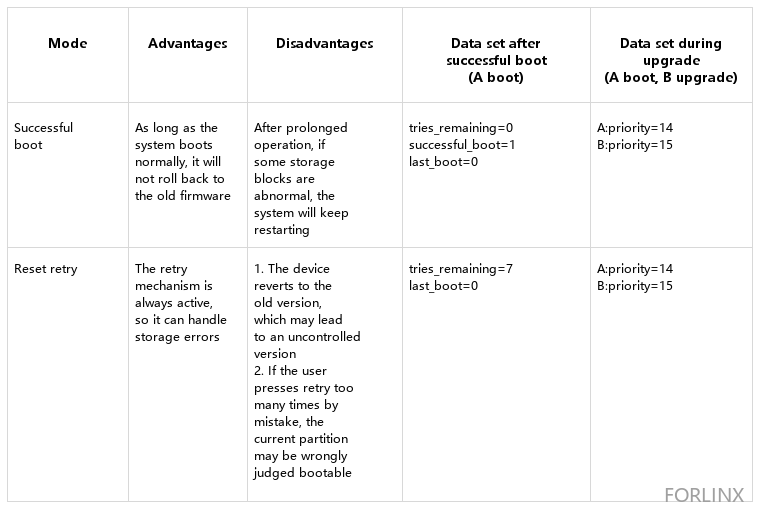
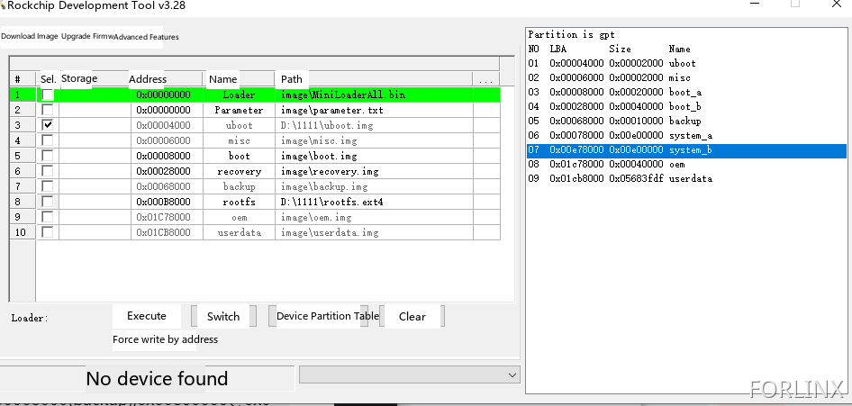
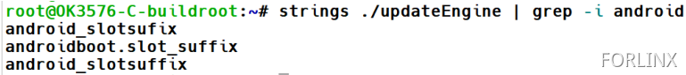

# OK3576 A/B Partitioning on Buildroot 6.1.118

Document classification: □ Top secret □ Secret □ Internal information ■ Open

## Copyright

The copyright of this manual belongs to Baoding Folinx Embedded Technology Co., Ltd. Without the written permission of our company, no organizations or individuals have the right to copy, distribute, or reproduce any part of this manual in any form, and violators will be held legally responsible.
Forlinx adheres to copyrights of all graphics and texts used in all publications in original or license-free forms.
The drivers and utilities used for the components are subject to the copyrights of the respective manufacturers. The license conditions of the respective manufacturer are to be adhered to. Related license expenses for the operating system and applications should be calculated/declared separately by the related party or its representatives.

## **Overview**
OK3576 6.1.118 Buildroot System Using A/B Partitions

## Notes
**Do not mix the updateEngine tool with the one used on 6.1.84 systems**

## **Revision History**
| **Date** | **Document Version** | **Changes** |
| --- | --- | --- |
| 11/05/2026 | V1.0 | Initial release |


## Reference Documents
sdk/docs/cn/Linux/Recovery/Rockchip_Developer_Guide_Linux_Upgrade_CN.pdf

## Modifications
### U-Boot Modifications
Patch changes

```plain
diff --git a/u-boot/configs/OK3576-C_defconfig b/u-boot/configs/OK3576-C_defconfig
index 3176a61fa..6ed2d2e26 100644
--- a/u-boot/configs/OK3576-C_defconfig
+++ b/u-boot/configs/OK3576-C_defconfig
@@ -227,6 +227,7 @@ CONFIG_AVB_LIBAVB_AB=y
 CONFIG_AVB_LIBAVB_ATX=y
 CONFIG_AVB_LIBAVB_USER=y
 CONFIG_RK_AVB_LIBAVB_USER=y
+CONFIG_ANDROID_AB=y
 CONFIG_OPTEE_CLIENT=y
 CONFIG_OPTEE_V2=y
 CONFIG_OPTEE_ALWAYS_USE_SECURITY_PARTITION=y

```

A/B partitioning requires U-Boot support. If you need A/B partitioning, contact your sales representative to request a suitable U-Boot image.

### Buildroot Modifications
```shell
diff --git a/buildroot/configs/rockchip_ok3576-c_defconfig b/buildroot/configs/rockchip_ok3576-c_defconfig
index 67c3658be..053663a14 100644
--- a/buildroot/configs/rockchip_ok3576-c_defconfig
+++ b/buildroot/configs/rockchip_ok3576-c_defconfig
@@ -125,3 +125,11 @@ BR2_PACKAGE_PYTHON_NUMPY_ARCH_SUPPORTS=y
 BR2_PACKAGE_PYTHON_NUMPY=y
 BR2_PACKAGE_PYTHON_PIP=y
 BR2_PACKAGE_PYTHON_SETUPTOOLS=y

+#AB System
+BR2_PACKAGE_RECOVERY=y                        # Enable the upgrade function
+BR2_PACKAGE_RECOVERY_BOOTCONTROL=y            # Enable the boot control script
+BR2_PACKAGE_RECOVERY_RETRY=y     # Boot mode is retry; if not configured, the default is successful_boot
+BR2_PACKAGE_RECOVERY_USE_UPDATEENGINE=y       # Use the updateEngine program
+BR2_PACKAGE_RECOVERY_UPDATEENGINEBIN=y        # Build the updateEngine program
+BR2_PACKAGE_RECOVERY_NO_UI=y 
```

Depending on the upper-layer bootcontrol configuration, there are two boot modes: successful_boot and reset retry. The two modes are compared below:



Here we configure it as reset retry mode in Buildroot.

### Device Modifications
#### Modifying the defconfig File
```shell
diff --git a/device/rockchip/.chips/rk3576/OK3576_C_buildroot_defconfig b/device/rockchip/.chips/rk3576/OK3576_C_buildroot_defconfig
index c47e958c4..e4e51623c 100644
--- a/device/rockchip/.chips/rk3576/OK3576_C_buildroot_defconfig
+++ b/device/rockchip/.chips/rk3576/OK3576_C_buildroot_defconfig
@@ -7,6 +7,8 @@ RK_UBOOT_CFG="OK3576-C"
 RK_UBOOT_SPL=y
 RK_KERNEL_CFG="OK3576-C-linux_defconfig"
 RK_KERNEL_DTS_NAME="OK3576-C-linux"
+RK_PARAMETER="parameter-ab.txt"
 RK_EXTRA_PARTITION_NUM=1
 RK_EXTRA_PARTITION_1_SRC="rk3576"
 RK_USE_FIT_IMG=y
+RK_AB_UPDATE=y


```

#### Adding the update-ab.img Packaging Rule Configuration File
```shell
diff --git a/device/rockchip/.chips/rk3576/package-file-ab b/device/rockchip/.chips/rk3576/package-file-ab
new file mode 100644
index 000000000..f8787167e
--- /dev/null
+++ b/device/rockchip/.chips/rk3576/package-file-ab
@@ -0,0 +1,12 @@
+# NAME PATH
+package-file   package-file
+parameter      parameter.txt
+bootloader     MiniLoaderAll.bin
+uboot  uboot.img
+misc   misc.img
+boot_a boot.img
+boot_b boot.img
+recovery        recovery.img
+system_a       rootfs.img
+system_b       rootfs.img
+userdata       userdata.img
```

#### Modifying the Partition Table Description File
```shell

diff --git a/device/rockchip/.chips/rk3576/parameter-ab.txt b/device/rockchip/.chips/rk3576/parameter-ab.txt
index efae0c58f..b33b68ea5 100644
--- a/device/rockchip/.chips/rk3576/parameter-ab.txt
+++ b/device/rockchip/.chips/rk3576/parameter-ab.txt
@@ -9,4 +9,7 @@ CHECK_MASK: 0x80
 PWR_HLD: 0,0,A,0,1
 TYPE: GPT
 GROW_ALIGN: 0
-CMDLINE: mtdparts=:0x00002000@0x00004000(uboot),0x00002000@0x00006000(misc),0x00020000@0x00008000(boot_a),0x00040000@0x00028000(boot_b),0x00010000@0x00068000(backup),0x00e00000@0x00078000(system_a),0x00e00000@0x00e78000(system_b),0x00040000@0x01c78000(oem),-@0x01cb8000(userdata:grow)
+CMDLINE: mtdparts=:0x00002000@0x00004000(uboot),0x00002000@0x00006000(env),0x00002000@0x00008000(misc),0x00020000@0x0000a000(boot_a),0x00040000@0x0002a000(boot_b),0x00010000@0x0006a000(backup),0x00e00000@0x0007a000(system_a),0x00e00000@0x00e7a000(system_b),0x00040000@0x01c7a000(oem),-@0x01cba000(userdata:grow)
+uuid:system_a=b3190000-0000-4b61-8000-00d100007443
+uuid:system_b=920f0000-0000-480f-8000-4b5900004973
+uuid:boot_a=83000000-0000-404a-8000-4565000029ca
\ No newline at end of file

```

#### Modifying the updateEngine Application
```shell
diff --git a/external/recovery/update_engine/rktools.c b/external/recovery/update_engine/rktools.c
index cd909df82..06bd82e30 100644
--- a/external/recovery/update_engine/rktools.c
+++ b/external/recovery/update_engine/rktools.c
@@ -160,6 +160,7 @@ int getCurrentSlot()
     close(fd);
     char *slot = strstr(cmdline, "android_slotsufix");
     if (slot == NULL) slot = strstr(cmdline, "androidboot.slot_suffix");
+    if (slot == NULL) slot = strstr(cmdline, "android_slotsuffix");
     if (slot != NULL) {
         slot = strstr(slot, "=");
         if (slot != NULL && *(++slot) == '_') {

```

## Verification
Rebuild the image.

**Note: Delete OK3576-linux-source/prebuilts/forlinx/rk3576/buildroot/rootfs.ext4 and rebuild the file system so that the updateEngine tool is updated.**

```plain
./build.sh 
```

Flash sdk/rockdev/update.img

Read the device partition table to see the A/B images and system.



Replacing the updateEngine Tool

The /usr/bin/updateEngine installed by default in the Buildroot file system is outdated and does not match the current system; running it will exit immediately.

Manually copy **SDK/buildroot/output/rockchip_ok3576-c/build/recovery-develop/updateEngine** to the development board.

To mark the current partition as bootable through misc, run this after the system has booted successfully, indicating a successful startup:

```plain
./updateEngine --misc=now
```

Boot the other partition

```plain
./updateEngine --misc=other --reboot
```

Procedure:

- Write a command at offset 4K in misc; this command boots the other partition;

- Reboot
  Optional parameters:
  
- --reboot: If omitted, the machine will not reboot immediately; the change takes effect on the next reboot.

**Note: The updateEngine program sets this automatically after an OTA upgrade; no manual setting is needed.**

## Tips

### Reset retry Mode

Note that the default configuration is reset retry mode, so in the U-Boot log (the red line below), successful_boot is always 0. This indicates a healthy state, not a failure to mark the boot as successful.

The actual "boot health counter" is **tries_remain**. Each normal boot of slot **A** decrements it by 1 and writes the value back;

After the system boots normally, run updateEngine --misc=now to restore it to 7.

If slot **A** fails to boot repeatedly, or if updateEngine --misc=now is not run after a successful boot, **tries-remain** decreases to 0 and U-Boot rolls back to slot **B**.

```shell
U-Boot 2017.09 (Jul 07 2026 - 18:23:25 +0800)

Model: Forlinx OK3576-C board
MPIDR: 0x0
PreSerial: 0, raw, 0x2ad40000
DRAM:  2 GiB
Sysmem: init
Relocation Offset: 7d906000
Relocation fdt: bb7f9e30 - bb7fecd8
CR: M/C/I
optee api revision: 2.0
mmc@2a310000: 1, mmc@2a330000: 0
Bootdev(atags): mmc 0
MMC0: HS400 Enhanced Strobe, 200Mhz
PartType: EFI
A/B-slot: _a, successful: 0, tries-remain: 7
TEEC: Waring: Could not find security partition
DM: v2
RESC: 'boot_a', blk@0x0001e426
resource: sha256+
FIT: no signed, no conf required
```

### Successful_boot Mode

In this mode, after one successful boot, running updateEngine --misc=now permanently marks the boot as successful and disables rollback.

The U-Boot log then shows:

```shell
A/B-slot: _a, successful: 1, tries-remain: 0
```

### Checking Whether updateEngine Is the Correct Version
```shell
strings /usr/bin/updateEngine | grep slotsuffix
```



If the output does not contain **android_slotsuffix**, it is an old, incorrect binary.

### Automatically Marking a Successful Boot at Startup
In reset retry mode, to automatically mark a successful boot when the system starts, configure a startup script.

```shell
root@OK3576-C-buildroot:~# cat /etc/init.d/S99_bootcontrol
case "$1" in
  start)
        /root/updateEngine --misc=now
        ;;
  stop)
        printf "stop finished\n"
        ;;
  *)
        echo "Usage: $0 {start|stop}"
        exit 1
        ;;
esac
exit 0

```

Modify this script; the highlighted area is the **actual path to the updateEngine tool**.
